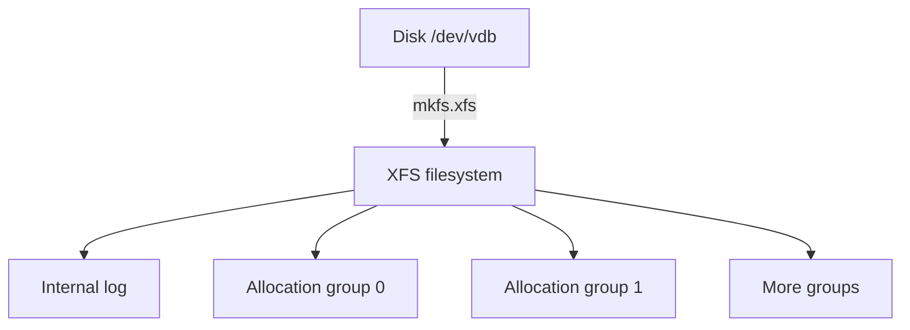

# Creating and Inspecting XFS

Astronaut, an empty cargo hold has no shelves. `mkfs.xfs` builds XFS shelves inside it. On this page you build one, read its layout, dock it with a mount option, and write it into the logbook so it docks at every launch.

## Build an XFS filesystem

XFS is a filesystem designed for large holds and many parallel writers. Build one first, then look at what the tool made.

### Format a disk

Find the blank disks first. Device names follow the order the disks were attached, so always check:

<!-- astrona:playground:renew -->

```sh
lsblk
```

Look for the 1 GB and the 2 GB disks with no filesystem. The commands below use `/dev/vdb` for the 1 GB disk; use your name if it differs. Build the filesystem and give it a label, the painted name on the hold:

```sh
sudo mkfs.xfs -L CARGO /dev/vdb
```

`mkfs.xfs` prints a summary of the layout it built, and you will read the same facts again in the next step. If the disk already holds a filesystem, `mkfs.xfs` refuses and asks for `-f` (force). Never add `-f` before you have checked with `lsblk -f` that the disk holds nothing you need.

Confirm the result with `blkid`:

```sh
sudo blkid /dev/vdb
```

The line shows `LABEL="CARGO"`, a `UUID` and `TYPE="xfs"`. The UUID is the hold's serial number.

## Read the layout with xfs_info

The tool `xfs_info` prints the layout of an XFS filesystem. It works on a mounted filesystem, so mount the hold first.

### Mount and look

```sh
sudo mkdir -p /srv/cargo
sudo mount /dev/vdb /srv/cargo
xfs_info /srv/cargo
```

The output has one group of lines per structure. Output differs by disk size, so read the names, not the numbers. These are the lines that matter:

- `meta-data=` holds the number of **allocation groups** (`agcount`) and the size of each (`agsize`).
- `data =` holds the block size (`bsize`) and the total number of blocks (`blocks`).
- `log =` holds the size of the log, called `internal log` when it lives inside the same disk.

### Allocation groups and the log

XFS cuts the hold into equal sections called **allocation groups**. Think of them as separate decks with their own cargo lists. Each deck keeps its own free-space map, so several crew members can store cargo on different decks at the same moment, without waiting for one shared list.

The **log** is the cargo officer's notebook. XFS writes each change to the log before it makes the change, like the journal in ext4. After a crash, the kernel replays the log at the next mount.

The picture below shows how the pieces sit in one hold.



The filesystem holds one log and several allocation groups, each with its own free-space list.

### Why XFS can grow but never shrink

Adding a deck at the end of the hold is easy: the new space becomes new allocation groups, or makes the last one bigger. Taking a deck away is not supported. The cargo lists of every deck would need to be rewritten, and XFS has no tool for that. To make an XFS filesystem smaller, you copy the data out, build a smaller filesystem and copy the data back.

## Mount options and persistence

A mount option changes how the kernel treats the hold after it docks. The logbook `/etc/fstab` makes the dock happen at every launch.

### Mount with noatime

Every read normally updates the "last access time" on the cargo tag. The option `noatime` switches that off, so reads cause no writes. Dock again with it:

```sh
sudo umount /srv/cargo
sudo mount -o noatime /dev/vdb /srv/cargo
findmnt /srv/cargo
```

The `OPTIONS` column of `findmnt` lists `noatime` next to `rw`. The kernel's XFS driver is the part that honours the option.

### Make the mount survive a reboot

A mount you typed by hand is lost when the ship lands. To keep it, add a line to `/etc/fstab`. Use the UUID, because `/dev/vdb` can change name when disks are attached in another order. Print the UUID first:

```sh
sudo blkid -s UUID -o value /dev/vdb
```

Add this line to `/etc/fstab`, with `<UUID>` replaced by the value printed above. Files under `/etc` are changed with `sudo`:

```sh
echo 'UUID=<UUID>  /srv/cargo  xfs  defaults,noatime  0  0' | sudo tee -a /etc/fstab
```

The last two fields are `0 0`: the dump flag is off, and the boot-time check is off because XFS does not use `fsck` at boot. Check the logbook before any reboot:

```sh
sudo umount /srv/cargo
sudo findmnt --verify
sudo mount -a
findmnt /srv/cargo
```

`findmnt --verify` finds typos in `/etc/fstab`. `mount -a` docks everything in the logbook, so `findmnt` now shows `/srv/cargo` as `xfs` again, docked by your logbook line.

## Common pitfalls

> [!WARNING]
> - `mkfs.xfs` destroys everything on the disk it formats. Check the name with `lsblk -f` before you press Enter.
> - `mkfs.xfs -f` overwrites an existing filesystem without asking again.
> - XFS cannot shrink. Plan the size, because growing is the only direction.
> - Mounting by `/dev/vdb` in `/etc/fstab` can break when device names move. Use `UUID=` or a label.
> - Test `/etc/fstab` with `findmnt --verify` and `mount -a` before you reboot.
