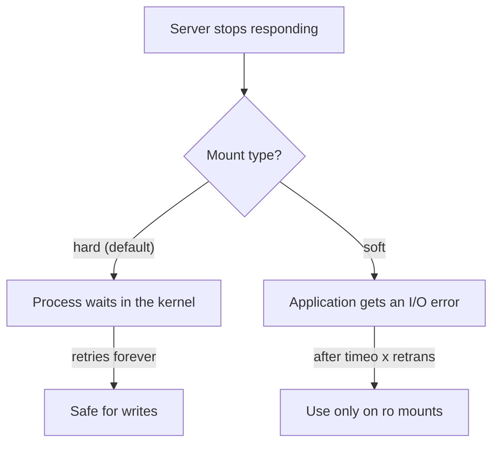

# Mounting, Read-Only & a Down Server

The export now sits in the server's kernel table (`sudo exportfs -v` on `server` shows it). This part covers the client half: finding what's on offer, mounting it, what a read-only export actually enforces, and — the option that matters most in an outage — what happens to a client when the server stops answering.

## The client side: discover, then mount

Before mounting, ask the server what it exports and to whom with `showmount -e <server>` — `showmount` reports what an NFS server is sharing, and `-e` narrows that to the **e**xport list. This is a direct RPC query against `mountd`, the same daemon that will handle the actual mount request — so a successful `showmount` is also a decent sanity check that the RPC stack is up. If your client's address is covered and the path is listed, mount it with the standard `mount` command and `-t nfs`.

### See it in your playground

On `client`:

<!-- astrona:playground:renew -->

```sh
showmount -e server
sudo mount -t nfs server:/nfs/share /mnt/nfs
df -h -t nfs4 -t nfs
cat /mnt/nfs/report.txt
```

Expect something like:

```text
Export list for server:
/nfs/share 10.10.20.0/24

Filesystem            Size  Used Avail Use% Mounted on
server:/nfs/share      15G  2.1G   12G  15% /mnt/nfs
shared report from server
```

`showmount -e` confirms the export and its allowed network. After `mount`, `/mnt/nfs` is part of the client's own tree — `df` shows it as a filesystem and `cat` reads a file straight from `server`, with every read now going directly to `nfsd` rather than back through `mountd`.

## Read-only means read-only

An `ro` export is enforced by the server. A client can mount it, read everything, and cannot create or modify files regardless of local permissions or `sudo` — the check happens in `nfsd` on `server`, not on the client, so no amount of client-side privilege changes it.

### See it in your playground

On `client`, with `/mnt/nfs` mounted:

```sh
sudo touch /mnt/nfs/newfile
```

Expect something like:

```text
touch: cannot touch '/mnt/nfs/newfile': Read-only file system
```

The write is refused at the filesystem level. To allow writes you would change `ro` to `rw` in `/etc/exports` on `server`, re-run `sudo exportfs -arv`, and remount on the client.

## When the server goes away: `hard` vs `soft`

By default an NFS mount is **`hard`**: if the server stops responding, the client's RPC layer retries the request indefinitely, and any process touching the mount blocks in the kernel until the server returns. Such a process is usually unkillable, even with `kill -9`, because it is stuck in a kernel wait, not a user-space loop a signal can interrupt — the same "uninterruptible sleep" (`D` state in `ps`) you'd see waiting on a slow local disk. For data you cannot afford to have written incorrectly, this is the correct behaviour: the RPC call eventually completes once the server is back, rather than the client ever having to guess whether a write landed.

A **`soft`** mount changes that retry policy: the RPC layer gives up after `retrans` retries of `timeo` (tenths of a second) each, and returns an I/O error to the application instead of blocking forever. The system stays responsive, but a `soft` mount can let a write's RPC call time out with the write actually having landed on the server (or not) — the client has no reliable way to know which, so it is advisable **only for read-only mounts**, where a failed retry just means "try the read again," not "did that write happen or not."

The old `intr` option (make operations interruptible by signals) is obsolete: since Linux 2.6.25 it is a no-op, because the kernel already lets fatal signals break a `hard` mount's wait. Do not rely on it. For a responsive read-only client, use `soft` with a modest `timeo` and `retrans`; otherwise keep the `hard` default.



### See it in your playground

On `client`:

```sh
sudo umount /mnt/nfs
sudo mount -t nfs -o soft,timeo=30,retrans=2 server:/nfs/share /mnt/nfs
mount | grep /mnt/nfs
```

Expect something like:

```text
server:/nfs/share on /mnt/nfs type nfs4 (rw,relatime,vers=4.2,...,soft,...,timeo=30,retrans=2,...)
```

The option string now shows `soft`, `timeo=30`, and `retrans=2`. This playground does not sever the network, so you will not see the I/O-error behaviour itself — but with these options a dead `server` would make the RPC layer give up and reads fail after roughly `timeo × retrans` tenths of a second instead of blocking forever.

> *`hard` versus `soft` is really a choice about what the client's RPC layer is allowed to give up on — and because NFS gives no way to ask "did my last write actually happen," giving up is only safe when nothing was being written.*

## Common pitfalls

> [!WARNING]
>
> - **`soft` on a read-write mount.** A timed-out write leaves the client unable to tell whether it landed — repeating it can duplicate data, not repeating it can lose it. Use `soft` only for `ro` mounts; use the `hard` default for anything writable.
> - **Reaching for `intr`.** It has done nothing since Linux 2.6.25. Fatal signals already interrupt `hard`-mount waits; for responsiveness tune `soft`/`timeo`/`retrans` instead.

## Your mission: NFS Enterprise Network Sharing Lab

You can now export a directory with `/etc/exports`, apply it with `exportfs`, and mount it over NFS, read-only. The mission asks you to export `/var/nfs/public` as a read-only share, mount it from `127.0.0.1` at `/mnt/nfs-share`, and show that files can be read but not written.

The mission runs on its own training ship. A playground cannot be paused, so remove it first to free memory; it always starts clean again:

```sh
astrona destroy section-020-module-02-playground
```

Then start the mission and connect to it:

```sh
astrona run --git git@github.com:astrona-io/ATS004.git -c sections/section-020/module-02/labs/lab-01
astrona ssh ats-004-lab-022
```

Read the task in [`question.md`](./labs/lab-01/question.md) and solve it on your own first. When you think you are done, send it for grading:

```sh
astrona submit -c sections/section-020/module-02/labs/lab-01
```

When the mission is done, remove it and start a fresh playground:

```sh
astrona destroy ats-004-lab-022
astrona run --git ssh://git@github.com/astrona-io/ATS004.git -c sections/section-020/module-02/playground
```
