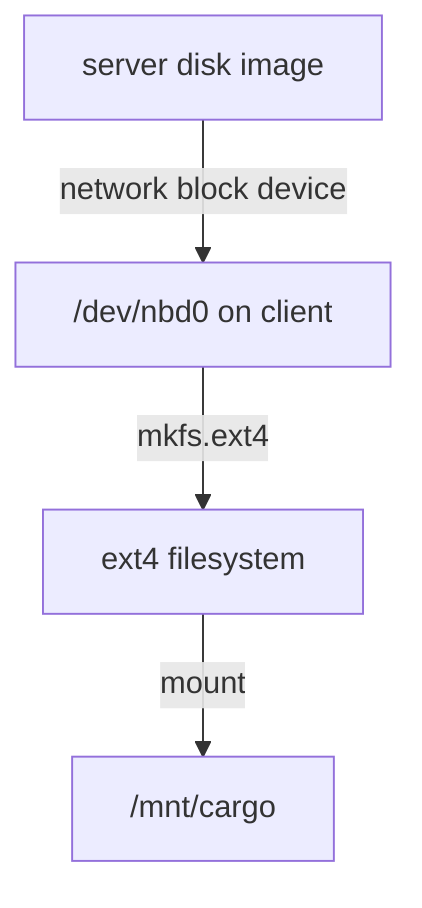

# Block Devices Versus Shared Files, and NBD

A network block device moves the border between the two ships. With a shared filesystem the server owns the shelves. With a network block device the server owns only the empty hold, and your ship owns the shelves. This part shows that difference with a small, real example.

## Who owns the filesystem?

When your ship docks an NFS share, the server has already built the shelves. You ask for files by name, and the server decides where they sit. Two ships can read the same file at the same time.

A network block device works one level lower. The server sends your ship a raw disk: numbered blocks, with no shelves and no labels. Your kernel treats it like a disk that is plugged in locally. You run `mkfs` on it, and you mount it.



The diagram shows that the client builds the filesystem on the remote disk, so the client is the only machine that should mount it.

> [!TIP]
> Never mount the same ext4 disk on two ships at once. Each ship keeps its own idea of what is on the shelves, and they will damage each other's cargo. A shared filesystem such as NFS exists for sharing. A network block device is a private disk that happens to sit far away.

## NBD: the simplest network disk

NBD means Network Block Device. The server publishes one or more named disks, called exports. The client connects an export to a device file named `/dev/nbd0`, `/dev/nbd1` and so on. Two programs do the work: `nbd-server` on the server and `nbd-client` on your ship. The kernel module `nbd` turns the device file into a real disk.

The server for this part is already running. It offers one export named `cargo`.

### See it in your playground

<!-- astrona:playground:renew -->

First list what the server offers:

```sh
sudo nbd-client -l server
```

The command asks the server for its export names. You should see the name `cargo` in the list.

Load the kernel module and connect the export to the first device file:

```sh
sudo modprobe nbd
sudo nbd-client server /dev/nbd0 -N cargo
lsblk /dev/nbd0
```

`nbd-client` does the connecting. `lsblk` now shows a disk named `nbd0` of 512 MB, with no partitions and no mount point. It is a bare hold.

### Use it like a local disk

Format it and dock it:

```sh
sudo mkfs.ext4 /dev/nbd0
sudo mount /dev/nbd0 /mnt/cargo
echo "first crate" | sudo tee /mnt/cargo/crate.txt
findmnt /mnt/cargo
```

`mkfs.ext4` ran on your ship, not on the server. `findmnt` shows `/mnt/cargo` with the type `ext4` and the source `/dev/nbd0`.

### Disconnect it cleanly

Undock the hold first, then cut the connection:

```sh
sudo umount /mnt/cargo
sudo nbd-client -d /dev/nbd0
lsblk /dev/nbd0
```

The `-d` option disconnects the device. Afterwards `nbd0` is back to size 0, because nothing is attached.

## Why NBD is not the exam favourite

NBD has no login and no encryption in this setup, and nothing brings the connection back after a restart. That is why real data centres use iSCSI. The next part does the same job with iSCSI. NBD is still worth knowing, because it is quick to set up and the commands above are short.

## Common pitfalls

> [!WARNING]
> - Running `nbd-client -d` while the disk is still mounted. Undock with `umount` first, or the disk cannot be removed cleanly.
> - Running `mkfs` on the wrong device. Check the size with `lsblk` first: `/dev/nbd0` here is 512 MB.
> - Forgetting `sudo modprobe nbd`. If the device file `/dev/nbd0` does not exist, the module is not loaded.
> - Mounting the same NBD export from two ships at once.
