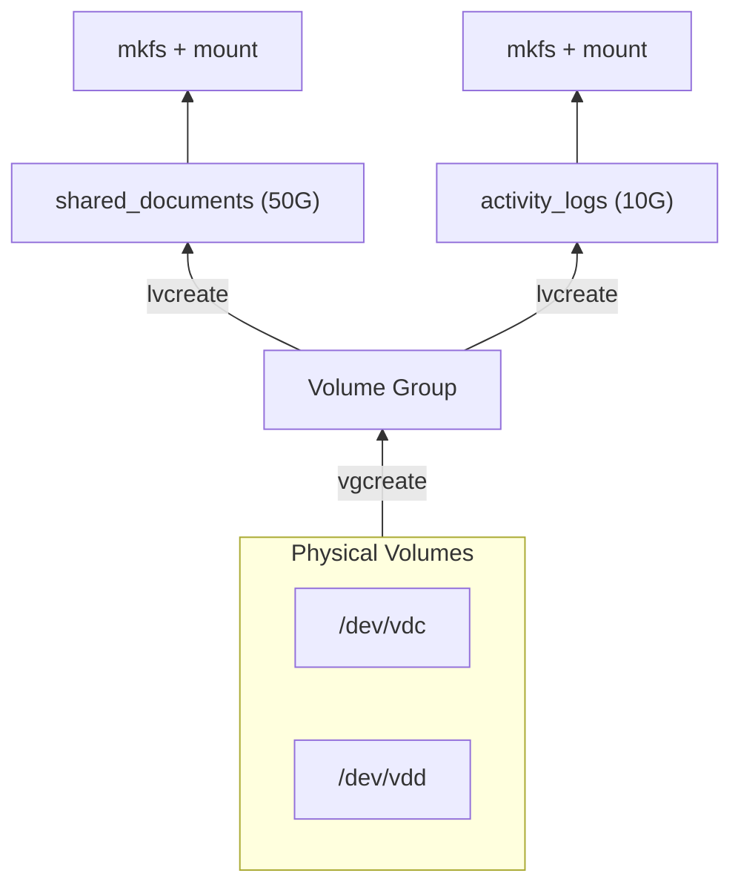

# Why LVM & the Three-Layer Model

A plain partition is a fixed byte range on one disk — resizing it means either shrinking a neighbor (if one exists and has room) or copying everything to bigger hardware. This part covers what LVM inserts between disks and filesystems to remove that rigidity, and names the three layers every later command operates on.

## The problem a partition table cannot solve

A partition table describes byte ranges directly on physical disk geometry: partition 2 starts here, is this many sectors long, ends there. That description is baked into the disk the moment you write it. Two consequences follow directly from that fact, not from any particular tool's limitation:

- **A partition cannot outgrow its disk.** There is nowhere else for the extra sectors to come from — the partition table only knows about the one disk it lives on.
- **Moving a partition's data to different physical disks means copying it.** The byte range *is* the identity; there's no layer of indirection to redirect without physically relocating the bytes.

> As an analogy: a plain partitioned disk is one cargo hold with welded walls. The room sizes are fixed on the day the ship is built. LVM is a shared cargo pool built from several holds, where each storage area is cut from the pool as you need it and can be resized later. The analogy breaks down because the pool can also grow by taking in another hold, and a welded hold cannot do that.

LVM fixes both problems the same way most abstraction layers do: by adding a level of indirection. Instead of a filesystem sitting directly on a partition's byte range, it sits on a logical volume — a name that LVM maps to wherever the underlying bytes actually are, and can remap without the filesystem ever noticing.

## The three layers

LVM stacks three layers, each built from the one below:

```text
  Logical Volumes    shared_documents (50G)   activity_logs (10G)   <- format & mount these
  ------------------------------------------------
  Volume Group       company_storage  (one pool of extents)
  ------------------------------------------------
  Physical Volumes   /dev/vdc   /dev/vdd             <- initialised disks/partitions
```

- A **physical volume (PV)** is one hold given to the pool: a whole disk or a partition that you have marked for LVM use.
- A **volume group (VG)** is the pool itself: one or more PVs joined into a single space.
- A **logical volume (LV)** is a storage area cut from the pool. It appears as a block device you format and mount; it does not have to fit on any single physical disk.

> [!NOTE]
> **A note on names, before any commands run**
>
> The diagram above has four different kinds of label in it, and if you haven't spent time in a Linux terminal before, they can look interchangeable when they are not:
>
> - `/dev/vdc` and `/dev/vdd` are **real device files that already exist on the machine**, created by the kernel before LVM is even installed. You never invent these — you only ever point commands *at* them, the same way you'd point at a USB stick that's already plugged in.
> - `company_storage` is **a name someone typed**, as the argument to a command called `vgcreate`, the first time they ran it. It means nothing to Linux by itself — it is a label, exactly like the name you'd give a new folder. Later in this module you will type this name yourself, and you can call it anything you like.
> - `shared_documents` and `activity_logs` are the same idea, one level down: names typed as arguments to a command called `lvcreate`. Again, invented on the spot, not built in.
> - `pvcreate`, `vgcreate`, `lvcreate` themselves are different from all of the above: these are **fixed program names** that ship with LVM. Every Linux machine with LVM installed has a command called exactly `vgcreate` — that part never changes and you never rename it.
>
> So when you run `vgcreate company_storage /dev/vdc /dev/vdd`, only `/dev/vdc` and `/dev/vdd` are fixed by the system. `vgcreate` is a fixed program name. `company_storage` is a label being invented right there in that command — LVM will simply remember it and expect you to type it back later, the same way it would remember any other name you chose. Notice it also doesn't start with `vg` or `lv` — that's deliberate: a name that happens to start the same way a command does (like `vgdata`) is easy to mistake for part of the command syntax instead of a label you chose.
>
> Keep that distinction in mind through the rest of this module: **fixed** (device paths, command names) versus **invented** (VG names, LV names). No sequence of letters here is special or reserved — every invented name is just whatever the person running the command decided to type.



Concretely: with LVM you can start a database volume at 50 GB, and when it approaches full, add a new disk to the pool and grow the volume — and the filesystem on top of it — in a few seconds, with the database still running. Every remaining part of this module (and every later LVM operation) is really about one underlying structure that makes this possible.

## What actually makes the indirection work

The VG layer doesn't just group disks — it slices the pooled space into fixed-size chunks called **physical extents (PEs)**, 4 MiB each by default, and an LV is not a byte range at all. It is **a list of extent assignments**: `(this PV, extent N) → (this LV, extent M)`, one entry per extent the LV owns. At activation time, the kernel's **device-mapper** subsystem reads that list and builds a virtual block device that stitches the assigned extents into one linear address space — regardless of which physical disk each extent actually sits on.

That's the whole trick. A filesystem written on top only ever sees one contiguous device; it has no way to ask "which physical disk is byte X really on" and no reason to. LVM is free to move, relocate, or add extents to the underlying list, and the filesystem's view never changes shape.

The rest of this module builds that stack for the first time: creating PVs, pooling them into a VG, and carving out an LV. Editing an already-built stack live — moving extents between disks, growing and shrinking — uses the exact same list-of-assignments mechanism, just edited after the fact instead of built fresh.

> *A logical volume is not a place on disk — it's a list of extent assignments that device-mapper turns into one virtual disk. Every LVM command in this module and the next is either building that list or editing it.*

## Common pitfalls

> [!WARNING]
> - **Thinking an LV is a fixed place on one disk.** It is a list of extent assignments. It can sit on several disks, and LVM can move it later.
> - **Mistaking invented names for commands.** `company_storage` and `shared_documents` are labels you choose. `vgcreate` and `lvcreate` are fixed program names.
> - **Treating LVM as a backup or as protection.** It adds flexibility, not redundancy. A dead disk in a pool still loses the extents stored on it.
