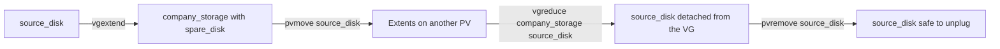

# Advanced LVM Operations

<!-- astrona:playground -->
> [!NOTE]
> 🧪 **Hands-on playground for this module** — a clean, throwaway machine to explore on. No task, no grading. Folder: [`playground/`](https://github.com/astrona-io/ATS004/tree/main/sections/section-030/module-02/playground)
>
> ```sh
> astrona run --git ssh://git@github.com/astrona-io/ATS004.git -c sections/section-030/module-02/playground
> astrona destroy section-030-module-02-playground
> ```

A pool of disks is already built, and this module changes it while it is in use: moving a volume's data off a dying disk, pulling that disk out of the pool, and growing a volume and its filesystem — all with the filesystem mounted and applications writing to it.

These operations rewrite where real data lives. A wrong device name or a missing `+` sign destroys data. The commands are short; the care is in reading the current state first.



That is the whole module in one migration: extend, move, reduce, remove — and it is also the shape of every part below, because every one of those verbs is really just an edit to a single underlying structure: an LV's list of extent assignments.

## How this module is organised

1. **[The LVM Stack, Recapped & Reading State](./course-01-stack-and-state.md)** — the extent-list model that explains every command below; the `pv`/`vg`/`lv` command-naming pattern; reading `pvs`/`vgs`/`lvs -o +devices` before touching anything.
2. **[Live Migration: pvmove](./course-02-pvmove-migration.md)** — adding a spare disk with `vgextend`, and what `pvmove` does underneath to move data off a live, mounted volume with zero downtime.
3. **[vgreduce, and Growing/Shrinking a Volume](./course-03-vgreduce-lvextend.md)** — retiring an emptied disk with `vgreduce` and `pvremove`; growing a volume live with `lvextend`; shrinking ext4 in the order that does not destroy data; and why XFS cannot shrink. Four graded missions end this part.
4. **[Removing Any PV, and Physical Disk Safety](./course-04-removing-any-pv-and-safety.md)** — the same three commands for a pool of any size, and what is still missing after `pvremove` before a real disk is safe to pull. One graded mission ends this part.
5. **[Growing in One Command](./course-05-growing-in-one-command.md)** — `lvextend -r`, `-l +100%FREE`, and growing XFS by hand with `xfs_growfs`. A graded mission ends this part.
6. **[Wrap-Up: Mission Debrief](./course-06-wrap-up.md)** — a recap, a self-check, and how to land the playground.

## Learning objectives

After this module you can:

- Explain an LV as a list of extent assignments, and derive from that model why relocating, growing, and removing extents all work the way they do.
- Add a disk to a live volume group with `pvcreate` + `vgextend`.
- Evacuate all extents off a physical volume with `pvmove` while its volume stays mounted, and explain why the migration is crash-safe and resumable.
- Remove an emptied disk from a pool with `vgreduce` and clear its LVM label with `pvremove`, and state the exact condition `vgreduce` checks before it will allow removal.
- Grow a logical volume with `lvextend` and then grow the filesystem with `resize2fs` (ext4) or `xfs_growfs` (XFS), and explain why those are two separate steps.
- Explain why `lvextend -L 20G` and `lvextend -L +20G` are dangerously different.
- Shrink an ext4 logical volume with `e2fsck -f`, `resize2fs`, then `lvreduce` — in that order — and explain why reversing it destroys data.
- State why XFS supports no shrink path, on either the filesystem or the volume, unlike ext4.
- Remove any one PV from a VG regardless of how many PVs it has or how an LV's extents are currently spread across them, and check beforehand whether the remaining PVs have enough free space to absorb the migration.
- List what `pvremove` does *not* do, and state the additional kernel/hardware-level steps a real (non-virtual) disk needs before it is actually safe to physically remove.
- Grow a volume and its filesystem in one command with `lvextend -r`, and hand it the rest of the pool with `-l +100%FREE`.

## Before you start

You should know the three LVM layers (PV, VG, LV), the physical extent, and the `pvs` / `vgs` / `lvs` inspection commands. The first part recaps them.

The linked playground gives you an Ubuntu server VM with a **pre-built stack**: volume group `company_storage` on two 1 GB disks, logical volume `shared_documents` (400 MiB ext4) with all its extents on the first disk, mounted at `/mnt/shared_documents` with sample files, and a third disk left raw as the replacement. The three disks' kernel names are written to `/etc/playground-disks` as `source_disk`, `second_disk`, `spare_disk` — read that file rather than assuming a `vdX` order, because the letters can shift between boots. Connect with `astrona ssh astro-section-030-module-02-playground` and run the command blocks in each part inside that VM.

Already comfortable with the earlier material and want to start later? Run `catchup part3` or `catchup part4` in the playground to skip straight to that starting state — see the playground's own overview doc, or run `catchup` with no arguments, for exactly what each one does before using it.

<!-- curriculum-practice -->
## Practice and assessment

- [Advanced LVM: Live Extent Migration & VG Reduction Lab](labs/lab-01/question.md): Move every allocated extent off the old disk with pvmove while the volume stays mounted; Remove the emptied disk from vg_migration with vgreduce and wipe its label with pvremove; Confirm the logical volume is still mounted at /mnt/lvm-migration with its data intact.
- [LVM Live Grow & Safe Shrink Lab](labs/lab-02/question.md): Grow lv_data with lvextend and grow its ext4 filesystem to match; Shrink lv_data to 350M safely by checking and shrinking the filesystem before the volume; Remount the volume at /mnt/resize-data with marker.txt unchanged.
- [LVM: vgextend a Live Pool, Then Evacuate a Disk Lab](labs/lab-03/question.md): Add the raw spare disk to the full volume group vg_live with pvcreate and vgextend; Evacuate the old disk with pvmove, remove it with vgreduce and wipe it with pvremove; Keep lv_active mounted at /mnt/lvm-live with its data intact throughout.
- [LVM: Growing an XFS Volume Lab](labs/lab-05/question.md): Grow the logical volume lv_xfs by 400M with lvextend; Grow the mounted XFS filesystem with xfs_growfs instead of resize2fs; Confirm the larger size and that the existing marker file survived.
- [LVM: Removing One PV Out of Three, Mixed Extents Lab](labs/lab-04/question.md): Show with lvs -o +devices that lv_data spreads across three disks; Evacuate the middle disk with pvmove onto the free space of the other two, then remove it with vgreduce and pvremove; Confirm vg_split keeps two physical volumes and lv_data stays mounted at its original size with data intact.
- [Persistent LVM Mount and One-Command Grow Lab](labs/lab-06/question.md): Mount a logical volume at boot with an /etc/fstab entry; Grow the volume and its filesystem together with lvextend -r; Confirm the data survived and mount -a still works.
- [LVM Volume Groups and Logical Volumes Capstone Lab](../capstone/labs/lab-01/question.md): Find the physical volume that holds vol1/data1 and remove it from vol1; Create the volume group vol2 on the freed disk with a 50M logical volume named p1; Format vol2/p1 with ext4.
