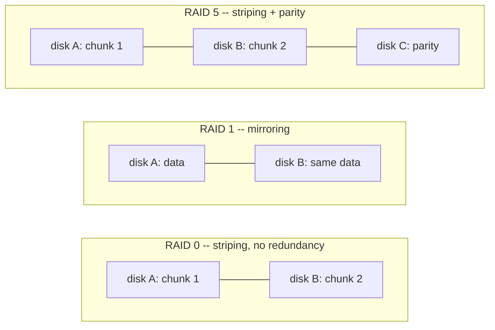

# RAID Levels

Before creating anything, this part covers the bargain each RAID level makes between usable space, disk-failure tolerance, and minimum disk count — because that choice, made once at `mdadm --create` time, is expensive to change later.

## The four levels

Each level is a different bargain between usable space, how many disk failures it survives, and how many disks it needs.

| Level | Layout | Min disks | Usable capacity | Survives | Notes |
| --- | --- | --- | --- | --- | --- |
| **0** | striping | 2 | 100% | **nothing** | Fast. One disk dies, all data is gone. Not redundancy — the opposite. |
| **1** | mirroring | 2 | 50% (size of one disk) | 1 disk (any) | Simple, robust. Reads can be faster; writes go to every mirror. |
| **5** | striping + one parity block | 3 | (N−1) disks | 1 disk (any) | Good capacity/safety balance. Rebuilds are slow and stress the survivors. |
| **10** | mirrored pairs, then striped | 4 | 50% | 1 disk per mirror pair | Fast and redundant; costs half the raw capacity. |

"Survives 1 disk" means the array keeps serving data in a **degraded** state until you replace the failed disk and the array rebuilds onto it. RAID is not a backup — it protects against a disk dying, not against deletion, corruption, or a fire.

> As an analogy: RAID 1 is a ship that carries two identical copies of its cargo manifest in two separate holds. If one hold floods, the other copy still tells the crew where everything is. RAID 5 spreads the manifest over three holds and adds a checksum page, so any one lost hold can be rebuilt from the other two. The analogy breaks down because RAID cannot undo a mistake: if the crew writes a wrong line, every copy gets the wrong line.

## Why the minimum disk counts are what they are

These aren't arbitrary limits — each minimum falls straight out of what the layout needs geometrically to do what it claims:

- **RAID 0 needs 2** because striping across one disk is meaningless — there's nothing to stripe *with*.
- **RAID 1 needs 2** because a mirror of one disk isn't a mirror.
- **RAID 5 needs 3** because "N−1 disks of usable capacity, survives 1 failure" requires at least one disk's worth of space dedicated to parity *and* at least two disks' worth of actual data to make that parity meaningful — below 3 disks, RAID 5 degenerates into RAID 1.
- **RAID 10 needs 4** because it is mirrored pairs, then striped across the pairs — one pair is just RAID 1, so a second pair is required before there's anything to stripe across.

This also predicts the parity math for RAID 5 directly: with N disks, one disk's worth of every stripe is parity (computed as the XOR of the other N−1 blocks), so usable capacity is (N−1)/N of the raw total, and losing any single disk still leaves enough information — the surviving data blocks plus the parity block — to reconstruct what was on it.

As a picture, the layouts differ in what each disk actually holds:



### See it in your playground

<!-- astrona:playground:renew -->

```sh
cat /proc/mdstat
lsblk -dn -o NAME,SIZE
```

Expect something like:

```text
Personalities : [raid1] [raid6] [raid5] [raid10]
unused devices: <none>

vda   15G
vdb    1G
vdc    1G
vdd    1G
vde    1G
```

`/proc/mdstat` lists the RAID levels the kernel can do and shows no arrays yet. The four 1 GB disks are the raw material an array is built from.

> *Every RAID level's minimum disk count and usable-capacity fraction falls out of the same question: how many disks does this layout need before the redundancy math actually works?*

## Common pitfalls

> [!WARNING]
> - **Mixing up capacity and safety.** RAID 0 gives all the space and no safety. RAID 1 and RAID 10 give half the space. RAID 5 gives N minus 1 disks of space.
> - **Picking RAID 5 with only two disks.** It needs at least three. Parity needs a third disk to live on.
> - **Treating RAID as a backup.** It survives a failed disk. It does not survive a deleted file.
> - **Choosing the level late.** The level is fixed when you run `mdadm --create`. Changing it later means a slow reshape or a rebuild from backup.
