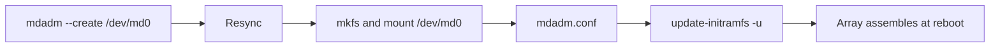

# Software RAID Fundamentals

<!-- astrona:playground -->
> [!NOTE]
> 🧪 **Hands-on playground for this module** — a clean, throwaway machine to explore on. No task, no grading. Folder: [`playground/`](https://github.com/astrona-io/ATS004/tree/main/sections/section-030/module-03/playground)
>
> ```sh
> astrona run --git ssh://git@github.com/astrona-io/ATS004.git -c sections/section-030/module-03/playground
> astrona destroy section-030-module-03-playground
> ```

RAID (Redundant Array of Independent Disks) combines several disks into one block device that is faster, or fault-tolerant, or both — depending on the layout you choose. Linux does this in software with the kernel's `md` (multiple devices) driver, managed by the `mdadm` command. The result, `/dev/md0`, is used exactly like any other disk: partition it, put a filesystem on it, mount it.

This module covers the common RAID levels and what each trades away, creating an array with `mdadm`, putting a filesystem on it, and the configuration step that makes the array reassemble itself at boot.



## How this module is organised

1. **[RAID Levels](./course-01-raid-levels.md)** — the capacity, redundancy and minimum-disk bargain each level makes, and why those minimums are what they are.
2. **[Creating & Persisting an Array](./course-02-creating-and-persisting.md)** — `mdadm --create`, what a RAID superblock records, a filesystem on the array, and making it survive a reboot. A graded mission ends this part.
3. **[Reading an Array Closely](./course-03-reading-an-array.md)** — `/proc/mdstat`, `mdadm --detail` and `mdadm --examine`, and the capacity check for RAID 5.
4. **[Wrap-Up: Mission Debrief](./course-04-wrap-up.md)** — a recap, a self-check, and how to land the playground.

## Learning objectives

After this module you can:

- Describe RAID 0, 1, 5, and 10 in terms of capacity, redundancy, and minimum disks, and derive each minimum from the layout's geometry.
- Create an array with `mdadm --create` and read its state from `/proc/mdstat` and `mdadm --detail`.
- Explain what a RAID superblock stores per member disk, and why that lets `mdadm` detect a stale disk.
- Put a filesystem on the array device and mount it.
- Persist an array with `/etc/mdadm/mdadm.conf` and an initramfs update, and explain why both are needed.
- Read an array with `/proc/mdstat`, `mdadm --detail` and `mdadm --examine`, and spot a stale member by its `Events` counter.
- Work out the usable capacity of a RAID 5 array and set its chunk size.

## Before you start

You should know how to create and mount a filesystem (`mkfs.ext4`, `mount`) and identify disks with `lsblk`.

The linked playground gives you an Ubuntu server VM with `mdadm` installed and **four raw 1 GB spare disks** (commonly `/dev/vdb`–`/dev/vde`), wiped on every boot. Run the command blocks in each part below in that VM after `astrona ssh section-030-module-03-playground`.

<!-- curriculum-practice -->
## Practice and assessment

- [RAID 5 Array Creation & Persistence Lab](labs/lab-01/question.md): Create a healthy RAID 5 array /dev/md0 from three raw disks; Format the array with ext4 and mount it at /mnt/raid-data; Record the array in /etc/mdadm/mdadm.conf and add an /etc/fstab entry keyed by UUID.
- [LVM Volume Groups and Logical Volumes Capstone Lab](../capstone/labs/lab-01/question.md): Find the physical volume that holds vol1/data1 and remove it from vol1; Create the volume group vol2 on the freed disk with a 50M logical volume named p1; Format vol2/p1 with ext4.
