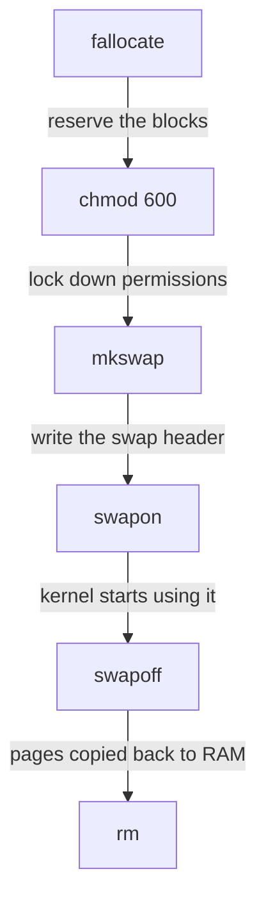

# Allocating, Activating and Deactivating a Swap File

This part is the mechanical life of a swap file. You turn an ordinary file into something the kernel will use as swap, switch it on, and take it back out again. The path is four commands: reserve the space, lock it down, write the swap header, switch it on.



The diagram shows the order. Skip a step and the next one either fails or leaves a hole in your safety.

## Allocating and securing the file

A swap file is an ordinary file whose blocks the kernel uses as swap. `fallocate -l <size> <path>` reserves the space by asking the filesystem to mark the blocks as allocated, without writing zeros. On ext4 and XFS this takes almost no time, because it only changes metadata.

This matters for swap. A sparse file (one with holes) would force the filesystem to find storage the first time each page is written. That is exactly the delay swap exists to avoid. A `dd` copy from `/dev/zero` also works, but it writes every byte, so it is much slower. On Btrfs a `fallocate`d file does not work as swap, because copy-on-write can move a page's physical place. The playground uses ext4, so plain `fallocate` is fine.

Permissions matter too. When the kernel swaps a page out, it writes raw memory into the file. That memory can hold passwords and keys. Set mode `600` (read and write for the owner, who is `root`) before you activate it. `swapon` only warns about a world-readable file and still activates it, so the check is yours.

<!-- astrona:playground:renew -->

### See it in your playground

Allocate the file, then lock it down:

```sh
sudo fallocate -l 512M /swapfile
ls -lh /swapfile
sudo chmod 600 /swapfile
ls -l /swapfile
```

Expect something like this:

```text
-rw-r--r-- 1 root root 512M Aug 29 12:00 /swapfile
-rw------- 1 root root 512M Aug 29 12:00 /swapfile
```

The file is 512 MiB at once, with no long wait, because `fallocate` did not write the data. After `chmod 600` the permission string is `-rw-------`, so only `root` can read it.

## Formatting and activating

`mkswap <path>` does not build a filesystem. It writes a **swap header**: the signature `SWAPSPACE2`, a random UUID for this swap area, the page size, and a map of the usable pages. The header is what separates "a file `swapon` will use" from "any old file". `swapon <path>` reads the header, checks the signature and the page size against the running kernel, and then registers the area. Both commands need `root`.

### See it in your playground

Format the file, switch it on and confirm:

```sh
sudo mkswap /swapfile
sudo swapon /swapfile
swapon --show
free -h
```

Expect something like this (the UUID differs on your ship, and is shortened here):

```text
Setting up swapspace version 1, size = 512 MiB (536866816 bytes)
no label, UUID=1b9e...c4

NAME      TYPE SIZE USED PRIO
/swapfile file 512M   0B   -2

               total        used        free      shared  buff/cache   available
Swap:          512Mi          0B       512Mi
```

`swapon --show` now lists `/swapfile`, and `free` shows 512 MiB of swap. The priority `-2` is the one the kernel picked on its own. If RAM fills now, idle pages go here instead of waking the OOM killer.

## Deactivating

`swapoff <path>` stops the kernel from using that area. First it copies every page that sits in the file back into RAM. So it needs enough free RAM, plus any other swap, to hold that data. On a starved system `swapoff` can be slow or fail with "Cannot allocate memory". Once it succeeds, the file is just a file again, and you can delete it.

### See it in your playground

Switch it off, then remove the file:

```sh
sudo swapoff /swapfile
swapon --show
sudo rm /swapfile
free -h
```

`swapon --show` prints nothing, and `free` shows `Swap:             0B          0B          0B` again. Almost nothing was in swap, so the copy-back was instant. On a busy ship it can take a while.

## Common pitfalls

> [!WARNING]
> - **World-readable swap.** A swap file that skips `chmod 600` exposes swapped-out memory, secrets included, to every local user. `swapon` only warns.
> - **A sparse file as swap.** Make the file with `fallocate` or `dd`, never with `truncate`. Holes make the first write to each page slow.
> - **`fallocate` on Btrfs.** The swap file fails there. Use a filesystem such as ext4 or XFS.
> - **Expecting the file to survive a reboot.** `swapon /swapfile` lasts until the next launch. Persistence needs a line in `/etc/fstab`.
> - **`swapoff` under memory pressure.** It must pull every swapped page back into RAM. If the pages do not fit, it fails and the swap stays active.
