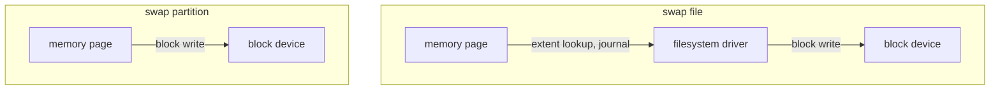

# Partition Versus File, and Creating the Partition

A swap file is a drawer inside a shared cabinet: you reach it through the cabinet's mechanism. A swap partition is a hatch in the floor that drops straight into a hold built for overflow. This part shows what that missing layer is and how to carve the partition.

## Partition versus file

A swap partition is any block device set aside for swap. It can be a physical partition such as `/dev/vdb1`, or an LVM logical volume such as `/dev/mapper/vg-swap`. You do not put a filesystem on it. `mkswap` writes a swap header straight onto the raw blocks.

The layer a swap file adds, and a partition skips, is the filesystem driver between the page and the block device.



The file path goes through the filesystem driver. The partition path goes straight to the block device.

That missing layer means no lookup from file offset to physical block, no journal update and no page-cache bookkeeping for the file. For the baseline swap of a machine, a partition (or an LVM volume) is the standard choice. A swap file is the quick add-on that needs no repartitioning. On SSDs the difference is small. It matters most on slow disks and heavily loaded ships.

## Creating the partition

Give the spare disk a partition table and one partition that spans it. The `linux-swap` keyword in `parted` sets the partition's type code, so tools such as `lsblk -f` and installers know it is swap. It does not write a filesystem, and it does not write the swap header. Formatting is `mkswap`'s job.

<!-- astrona:playground:renew -->

### See it in your playground

First confirm which disk is the spare one. The commands below use `/dev/vdb`. If `lsblk` shows a different name for the raw 1 GB disk, use that name:

```sh
lsblk /dev/vdb
sudo parted -s /dev/vdb mklabel gpt
sudo parted -s /dev/vdb mkpart swap linux-swap 1MiB 100%
sudo partprobe /dev/vdb
lsblk /dev/vdb
```

The first `lsblk` shows one 1 GiB disk with no children. The second shows the same disk with a child, `vdb1`, that spans nearly all of it (a little under 1 GiB, because the table and the 1 MiB start take some space). `partprobe` asked the kernel to re-read the table, so the new partition appears at once. The partition has the type "Linux swap" but no header yet.

## Common pitfalls

> [!WARNING]
> - **Partitioning the wrong disk.** `mklabel gpt` wipes the table of whatever disk you name. Check the name and size with `lsblk` first.
> - **Skipping `partprobe`.** The kernel may keep the old table, and `/dev/vdb1` does not appear yet.
> - **Thinking the `linux-swap` keyword formats the partition.** It sets a label only. There is no swap header until `mkswap` runs.
> - **Putting a filesystem on the partition.** Do not run `mkfs` on it. `mkswap` is the only formatting a swap device needs.
