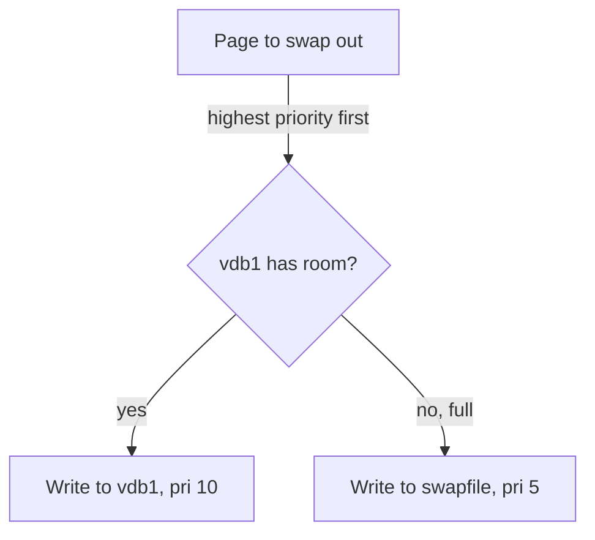

# Formatting, Activating and Priorities

A raw partition becomes swap in two steps: write a swap header, then switch it on. With two swap areas active, the kernel needs a rule for which one to fill first. That rule is the priority.

## Formatting and activating

`mkswap <device>` writes the swap signature and a UUID onto the partition. This is the same header a swap file gets, but now it lands on raw blocks. `swapon <device>` activates it. Because no filesystem is in the path, the reads and writes go straight to those blocks.

<!-- astrona:playground:renew -->

### See it in your playground

The commands below need a partition `/dev/vdb1` with no swap header yet. Format it, switch it on and list it:

```sh
sudo mkswap /dev/vdb1
sudo swapon /dev/vdb1
swapon --show
```

Expect something like this (the UUID differs on your ship and is shortened here):

```text
Setting up swapspace version 1, size = 1022 MiB
no label, UUID=7c2e...9a

NAME      TYPE      SIZE USED PRIO
/dev/vdb1 partition 1022M   0B   -2
```

`swapon --show` lists `/dev/vdb1` with `TYPE partition`, where a swap file shows `TYPE file`. The priority `-2` was chosen automatically.

## Priorities: preferring the fast area

A ship can run several swap areas at once. The kernel groups them into **priority buckets**. Areas with the *same* priority share the work: the kernel writes pages to them in turns (round robin). An area with a *higher* priority is filled completely before the kernel writes a single page to a lower one.

So mixed-speed swap behaves badly by default. A fast partition and a slow file at the same priority get equal turns, and the fast one is dragged down to the slow one's pace. The `pri=` value fixes this. User-set priorities run from 0 to 32767. A higher number wins, and the fill order is strict, not proportional.



The kernel only falls through to `/swapfile` when `/dev/vdb1` is full.

To see this you need a second area. Make a small swap file with the usual steps (`fallocate`, `chmod 600`, `mkswap`), switch all swap off, then switch both areas on with explicit priorities.

### See it in your playground

Build the file and activate both areas:

```sh
sudo fallocate -l 256M /swapfile
sudo chmod 600 /swapfile
sudo mkswap /swapfile
sudo swapoff -a
sudo swapon -p 10 /dev/vdb1
sudo swapon -p 5 /swapfile
swapon --show
```

Expect something like this:

```text
NAME      TYPE      SIZE USED PRIO
/dev/vdb1 partition 1022M   0B   10
/swapfile file      256M    0B    5
```

The `PRIO` column shows 10 for the partition and 5 for the file. Under memory pressure the kernel fills `/dev/vdb1` completely before it touches `/swapfile`.

## Common pitfalls

> [!WARNING]
> - **Leaving mixed-speed swap at the default priority.** The kernel then alternates between a fast and a slow area. Set `pri=` so the fast one fills first.
> - **Reading higher as "more often".** Higher priority means "filled first and completely", not "gets a bigger share".
> - **Assuming `swapon -p` persists.** The priority lasts until reboot. It must also be written in `/etc/fstab`.
> - **Running `mkswap` on an area that is in use.** Switch it off with `swapoff` first, or the command refuses.
