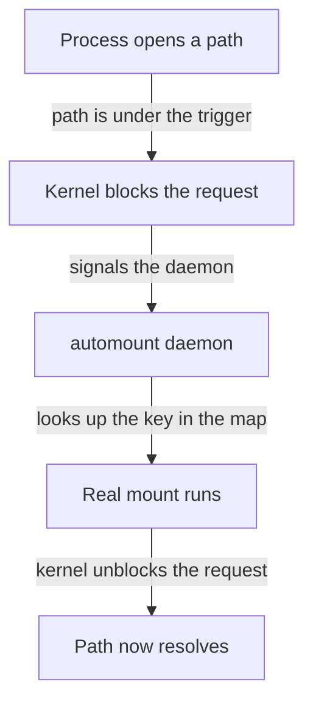
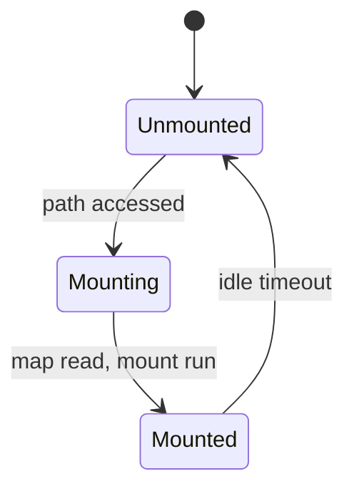

# How On-Demand Mounting Works, and Enabling autofs

`autofs` does not watch a directory the way a file monitor does. It sits in the kernel's request path for that directory and acts only when a request arrives. Once you see this trap-and-resume idea, the map files read as settings for it, not as rules to memorise.

## How on-demand mounting works

Think of `autofs` as a docking robot parked at a hatch. Nothing is docked at first. When a crew member knocks, the robot fetches the hold named on its map and docks it. When nobody has used the hold for a while, the robot undocks it again.

Three pieces work together:

1. **The `autofs` kernel module** owns a *trigger mount point*, a light pseudo-filesystem that the kernel treats in a special way. `mount` shows it as `type autofs`.
2. **The `automount` daemon** (the `autofs.service`) is the part that runs in user space. It registered the trigger with the kernel and holds the parsed maps in memory. The daemon runs the real mount.
3. **The requesting process**: whatever runs `cd`, `ls` or `open()` on a path under the trigger.

This is what happens on the first request:



The kernel does not poll anything. It parks one blocked request until the daemon answers. So there is no race between "check if mounted" and "mount it", as a script that does it by hand would have. The kernel is the single point where the two meet.

A mount moves through these states:



When the idle time passes with nothing open, the daemon unmounts the real filesystem. The trigger stays, ready for the next request.

## Enabling the service

`autofs` runs as a systemd service. `enable --now` starts it and sets it to start at every launch. With no map entries of your own, it runs but manages nothing.

<!-- astrona:playground:renew -->

### See it in your playground

Start the service and check it:

```sh
sudo systemctl enable --now autofs
systemctl status autofs --no-pager
```

Expect something like this (shortened):

```text
● autofs.service - Automounts filesystems on demand
     Loaded: loaded (/lib/systemd/system/autofs.service; enabled; ...)
     Active: active (running) since ...
```

`active (running)` and `enabled` mean the daemon is up and will return after a reboot. It has read `/etc/auto.master`, but that file holds no real entries yet, so nothing is under its control.

## Common pitfalls

> [!WARNING]
> - **Thinking `autofs` polls.** It never checks anything between requests. The kernel blocks one request and asks the daemon for a name.
> - **Using `start` and forgetting `enable`.** The service then stops at the next launch. Use `enable --now`.
> - **Expecting a mount right after enabling.** Nothing is mounted until a map says what to mount and something asks for it.
> - **Reading a long `status` and missing the error.** Look for `Active: active (running)`. A `failed` state means a map has a syntax problem.
