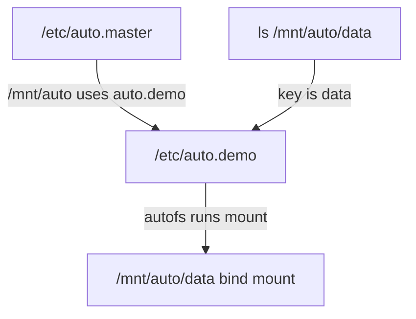

# The Master Map, Triggering and Idle Unmount

The robot has two lists. The master map says which hatches it guards. A second file, the map, says what to dock at each one. This part walks one request from the moment a process touches a path to the moment the robot lets the hold go.

## The master map: /etc/auto.master

`/etc/auto.master` lists the directories that `autofs` controls. Each line has three parts:

```text
/mnt/auto    /etc/auto.demo    --timeout=15
```

1. **The managed directory**, `/mnt/auto`. `autofs` takes ownership of it. When requests land on keys *under* the directory, the map is an **indirect map**.
2. **The map file**, `/etc/auto.demo`. When something is requested under `/mnt/auto`, `autofs` looks here for what to mount.
3. **Options**. `--timeout=15` means "unmount after 15 seconds with nothing open". Real systems use longer values such as `300` or `600`. 15 is short so you can watch it happen.

With more than one line, the daemon picks the managed directory that matches the path most closely. The most specific match wins.

The map file for this example holds one line, a local bind mount of `/srv/localdata`:

```text
data    -fstype=bind    :/srv/localdata
```

A request for a key passes through both files before `autofs` runs the real `mount`:



The master map is read once, when the daemon starts or reloads, and kept in memory. Only the key lookup inside the map file happens live, for each request. That is why an indirect map can serve keys that did not exist when the daemon started.

Save this as `/etc/auto.demo` (a file under `/etc` is saved with `sudo`, for example `sudo nano /etc/auto.demo`):

```text
data  -fstype=bind  :/srv/localdata
```

<!-- astrona:playground:renew -->

### See it in your playground

The commands below need the `autofs` service running. Add the master line, then reload so the daemon reads it again:

```sh
echo '/mnt/auto  /etc/auto.demo  --timeout=15' | sudo tee -a /etc/auto.master
sudo systemctl reload autofs
mount | grep autofs
ls /mnt/auto
```

Expect something like this (shortened):

```text
/etc/auto.demo on /mnt/auto type autofs (rw,relatime,fd=7,pgrp=...,timeout=15,...)

(ls /mnt/auto prints nothing)
```

`mount` shows `/mnt/auto` with type `autofs`. That is the trigger. `ls /mnt/auto` prints nothing, because nothing has been requested yet. The `data` directory does not exist until the trap fires.

## Triggering a mount

The mount happens when a process touches a key under the managed directory. `ls`, `cd` or opening a file are all enough. That is the trap from the mechanism, firing for real.

### See it in your playground

Reach for the key and watch it dock:

```sh
ls /mnt/auto/data
cat /mnt/auto/data/hello.txt
mount | grep /mnt/auto
```

Expect something like this:

```text
hello.txt  notes.txt
hello from the on-demand bind mount

/etc/auto.demo on /mnt/auto type autofs (...)
/srv/localdata on /mnt/auto/data type none (rw,relatime,bind)
```

The `ls` triggered `autofs`. `/mnt/auto/data` now exists and shows the files from `/srv/localdata`. `mount` lists a second line: the real bind mount that the daemon made, on top of the trigger.

## The idle unmount

When nothing reads from the mount and no shell sits in it, the robot undocks it after the timeout. The trigger stays. Only the on-demand mount goes away, ready for the next knock.

### See it in your playground

Move your shell out, wait longer than the timeout, and look again:

```sh
cd ~
sleep 20
mount | grep /mnt/auto
```

Only the `autofs` line remains:

```text
/etc/auto.demo on /mnt/auto type autofs (...)
```

After about 15 quiet seconds the `bind` line is gone. The next `ls /mnt/auto/data` mounts it again. A shell that stays inside `/mnt/auto/data` keeps the mount busy, so the timeout never fires.

## Common pitfalls

> [!WARNING]
> - **Creating the key directory by hand.** `mkdir /mnt/auto/data` makes an ordinary folder, so the kernel never raises the "not found" that `autofs` needs. The daemon creates and removes those directories.
> - **Editing a map and expecting it to apply.** `autofs` does not watch files on disk. Run `sudo systemctl reload autofs` after every change.
> - **A shell sitting in the mount.** Your working directory counts as in use, and the idle timeout will not fire. `cd` out first.
> - **Mixing up the two lines in `mount`.** The `autofs` line is the trigger and is always there. The real filesystem line shows only while the hold is docked.
> - **Very short timeouts in production.** Constant docking and undocking adds delay and log noise. Use minutes in real systems.
