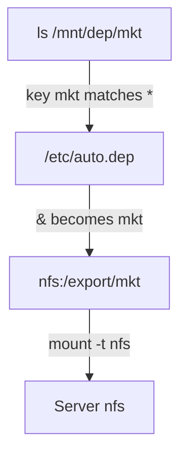

# Wildcards: One Line for Many Exports

Two departments need two map lines. Hundreds of home directories would need hundreds of lines, which no one can keep up. A wildcard line tells the robot how to build the target from the name that was asked for.

## The wildcard line

The wildcard entry looks like this:

```text
*   -fstype=nfs,ro,soft   nfs:/export/&
```

- `*` as the key matches **any** name requested under the managed directory.
- `&` in the target is replaced with **the text that `*` matched**. The map parser does this simple text swap when the request arrives. It is not shell expansion, so no quotes are needed.

A request for `/mnt/dep/mkt` makes `*` match `mkt`, and `&` becomes `mkt`. The daemon mounts `nfs:/export/mkt`. One line covers every `/export/<name>` the server has, including exports that did not exist when the file was written.



The key `mkt` fills in the `&`, and the daemon mounts the export of that name.

## The timeout on the master line

The idle timeout is part of the master line, not the map. Setting `--timeout=120` there means every key under that directory is undocked after 120 quiet seconds. Real systems use values like that. You change it by editing the master line and reloading.

## Replacing the explicit keys with a wildcard

The commands below need `/mnt/dep` under `autofs` control, as set up with the master line `/mnt/dep  /etc/auto.dep  --timeout=15`.

Save this as `/etc/auto.dep` (a file under `/etc` is saved with `sudo`), replacing the old content:

```text
*  -fstype=nfs,ro,soft  nfs:/export/&
```

Apply it:

```sh
sudo systemctl reload autofs
```

<!-- astrona:playground:renew -->

### See it in your playground

Ask for a key that the map never named:

```sh
ls /mnt/dep/mkt
cat /mnt/dep/mkt/mkt-readme.txt
mount | grep /mnt/dep
```

Expect something like this:

```text
mkt-readme.txt
marketing shared file

nfs:/export/mkt on /mnt/dep/mkt type nfs4 (ro,...)
```

`mkt` was never named in the map, yet it mounted. `*` caught the name and `&` built `nfs:/export/mkt`. A request for `/mnt/dep/eng` works the same way. To roll everything back, run `sudo cp /etc/auto.master.orig /etc/auto.master`, `sudo rm /etc/auto.dep` and `sudo systemctl reload autofs`.

## Common pitfalls

> [!WARNING]
> - **Pre-creating the key directory.** `mkdir /mnt/dep/eng` makes the path exist, so the kernel never signals `autofs`, and the NFS mount never happens.
> - **Forgetting to reload.** The daemon keeps the old map until `sudo systemctl reload autofs`.
> - **A wildcard that does not match the server's layout.** `nfs:/export/&` works only if every export is `/export/<key>`.
> - **Putting the timeout in the map file.** It belongs on the master line.
> - **A shell inside a mount.** It keeps the mount busy, so the idle timeout never fires.

## Your mission: Network autofs Wildcard Mounts

You can now write a wildcard map with `*` and `&`, and set the timeout on the master line. The mission asks you to make `/mnt/net/<name>` mount `127.0.0.1:/var/nfs/exports/<name>` on demand, and release it after exactly 120 seconds.

The mission runs on its own training ship. A playground cannot be paused, so remove it first to free memory. It always starts clean again:

```sh
astrona destroy section-050-module-02-playground
```

Then start the mission and connect to it:

```sh
astrona run --git git@github.com:astrona-io/ATS004.git -c sections/section-050/module-02/labs/lab-01
astrona ssh ats-004-lab-052
```

Read the task in [`question.md`](./labs/lab-01/question.md) and solve it on your own first. When you think you are done, send it for grading:

```sh
astrona submit -c sections/section-050/module-02/labs/lab-01
```

When the mission is done, remove it and start a fresh playground:

```sh
astrona destroy ats-004-lab-052
astrona run --git ssh://git@github.com/astrona-io/ATS004.git -c sections/section-050/module-02/playground
```

For a localhost NFS export, add `nobind` to the map options to force an NFS mount. Without it, autofs may use a local bind mount. Check the resulting type with `findmnt`.
