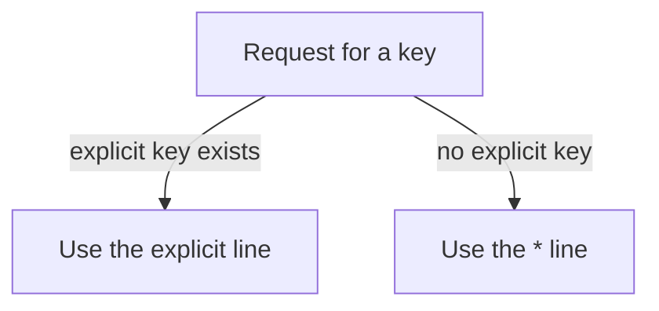

# Exceptions: One Key With Its Own Options

A wildcard is a good default. Sometimes one name needs different options. The robot checks the most specific line first, so you can keep the wildcard and add one exception above it.

## Explicit keys beat the wildcard

When a map holds both an explicit key and a `*` line, a request for that key matches the explicit line. The wildcard is the fallback for every other name. It never competes with a more specific line. The order of the lines in the file does not decide this.

Say the `eng` export needs a longer wait for each answer, and everything else can use the defaults. The map has two lines. The command `ls /mnt/dep/eng` uses the first. Any other name, such as `mkt`, uses the wildcard.



An explicit line always decides first, and the wildcard answers for every other name.

Save this as `/etc/auto.dep` (a file under `/etc` is saved with `sudo`):

```text
eng  -fstype=nfs,ro,soft,timeo=30  nfs:/export/eng
*    -fstype=nfs,ro,soft           nfs:/export/&
```

Apply it:

```sh
sudo systemctl reload autofs
```

<!-- astrona:playground:renew -->

### See it in your playground

Dock both exports and compare their options. Move your shell out first, so the mounts are not busy:

```sh
cd ~
ls /mnt/dep/eng /mnt/dep/mkt
mount | grep /mnt/dep
```

You see two `nfs4` lines. The one for `eng` includes `timeo=30`, because its own line said so. The one for `mkt` has the client's default value, because the wildcard line gave it no `timeo`. The same map gave two different sets of options.

A reload re-reads the map, but a hold that is already docked keeps the options it was mounted with. After you edit options, wait for the idle timeout, or undock the mount with `sudo umount /mnt/dep/eng`, and then ask for the key again.

## Common pitfalls

> [!WARNING]
> - **Expecting the options of the wildcard to merge with the explicit line.** The explicit line replaces them. Write every option you need on it.
> - **Changing options and checking at once.** A docked mount keeps its old options. Undock it first.
> - **Thinking line order matters.** An explicit key wins wherever it sits in the file.
> - **Forgetting `ro` on the exception.** The wildcard line made the other exports read-only. The exception must say so itself.
