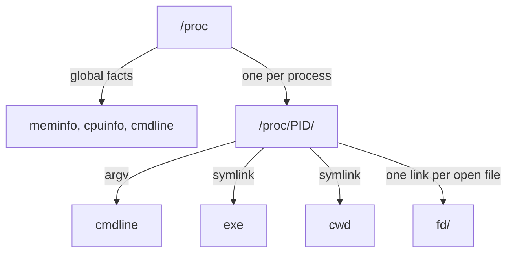

# /proc as a Live View & System-wide Files

`/proc` looks like a directory tree, and every normal tool (`cat`, `ls`, `grep`) treats it as one. But nothing under `/proc` is stored on disk. This part explains the mechanism that makes that true, then uses it to read the two most common system-wide facts: memory and CPU.

## `/proc` is a live view, not files

Start with one concrete case. A file on a disk has a size, and `ls -l` shows it. A file under `/proc` has no size, yet it holds real text. That puzzle has one answer, and it is the whole idea of this module.

> As an analogy: `/proc` is the ship's instrument panel. The fuel gauge is not a stored document. It is a needle wired to a live sensor. Reading `/proc/meminfo` likewise makes the kernel sample its current state and write it out for you. The analogy breaks down because you can also *write* to some `/proc` files to change kernel behaviour, like a gauge you can push on. A later part shows that.

### How the kernel builds the answer

`/proc` is a **procfs**, a filesystem type implemented entirely in kernel code with no backing store. No disk block anywhere holds the bytes of `/proc/meminfo`. Each file is wired to a kernel function instead of a list of disk blocks.

When something opens and reads `/proc/meminfo`, the virtual filesystem layer (the dispatch layer that also routes reads to ext4 or XFS) calls that function right then. The function walks the kernel's live memory counters and writes a fresh text report. Close the file and nothing is kept. Read it again a second later and the numbers may differ, because the function ran again.

That is why `ls -l` reports a length of 0 for most `/proc` files. There is no stored byte count, because there are no stored bytes. There is only a function that has not been asked to run yet.

<!-- astrona:playground:renew -->

### See it in your playground

Run these three commands. The first lists the top of `/proc`, the second asks for the file size, and the third reads the file.

```sh
ls -l /proc | head
stat -c '%s bytes  %n' /proc/meminfo
head -n 3 /proc/meminfo
```

Expect something like this (the numbers on your ship differ):

```text
dr-xr-xr-x  9 root root 0 Aug 29 12:00 1
dr-xr-xr-x  9 root root 0 Aug 29 12:00 1234
-r--r--r--  1 root root 0 Aug 29 12:00 meminfo
...
0 bytes  /proc/meminfo
MemTotal:        2019684 kB
MemAvailable:    1650000 kB
```

`stat` says `/proc/meminfo` is 0 bytes, yet `head` prints real numbers. The read made the kernel generate the text. The numbered directories at the top are one per running process, and the next part opens them.



The diagram shows the two halves of `/proc`: global files at the top, and one directory per process with its own files inside.

## System-wide files

The top level of `/proc` holds facts about the whole ship. Each file has its own generator function. This section names the three you meet most often and shows that the tools you already use read them.

### What each file holds

- `/proc/meminfo` is the full, unrounded memory report. The `free` command is only a formatter over it.
- `/proc/cpuinfo` describes each CPU. The kernel walks its per-CPU data when you read it, so a CPU added or removed shows up at once.
- `/proc/cmdline` is the exact string the bootloader gave the kernel. It is the one file here that does not change after boot, because nothing samples it again.

### See it in your playground

Compare the raw numbers with what `free` prints.

```sh
grep -E '^(MemTotal|MemAvailable|MemFree):' /proc/meminfo
free -k | head -n 2
```

Expect something like this:

```text
MemTotal:        2019684 kB
MemFree:          140000 kB
MemAvailable:    1650000 kB
               total        used        free      shared  buff/cache   available
Mem:         2019684      ...          140000      ...        ...       1650000
```

The `total` and `available` columns of `free -k` match `MemTotal` and `MemAvailable`. The `free` command opens `/proc/meminfo` and reformats what it reads. The file is the source, not a copy.

> *Every `/proc` read is a function call dressed as a file read. That one fact explains the 0-byte size, why the numbers are always current, and why a process directory vanishes the moment the process exits.*

## Common pitfalls

> [!WARNING]
> - **Expecting `/proc` files to have a size.** Almost all report 0 bytes because the content is generated at read time. Use `cat` or `grep` to see what is inside, not the size.
> - **Treating `/proc/meminfo` as a stored report.** It is generated on every read. Two reads a second apart can differ, so compare numbers from one read.
> - **Reading `MemFree` as "memory left".** The kernel uses spare memory as cache. `MemAvailable` is the better figure for how much a new program can use.
