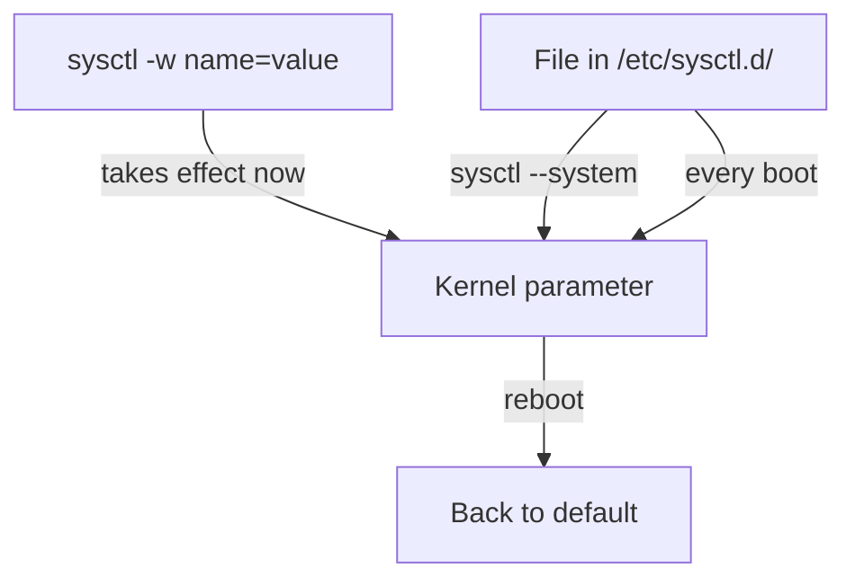

# sysctl: Persisting and Precedence

A runtime write to `/proc/sys` is gone after a reboot. This part makes a change last by writing it in a file that the ship reads at every launch, then explains which file wins when two files set the same key.

## Making a change persist

Nothing about a raw write is recorded outside the running kernel, so there is nothing to restore at the next launch. Persistence means a standing order that replays the write each time. That order is a `.conf` file under `/etc/sysctl.d/`. The service `systemd-sysctl.service` reads it early in boot and issues the same `name = value` writes.

### Write the file, then apply it

<!-- astrona:playground:renew -->

Save this as `/etc/sysctl.d/99-playground.conf`. A file under `/etc` is saved with `sudo`, for example `sudo nano /etc/sysctl.d/99-playground.conf`:

```text
net.ipv4.ip_forward = 1
```

Apply it. `sysctl --system` reads the files the way boot does:

```sh
sudo sysctl --system
```

Then check the result:

```sh
sysctl net.ipv4.ip_forward
```

### See it in your playground

You ran the three steps above on your playground. The output of `sudo sysctl --system` lists each file it reads, with a line like `* Applying /etc/sysctl.d/99-playground.conf ...` followed by the value it set. The check prints `net.ipv4.ip_forward = 1`. The setting would now survive a reboot.

When you are done, remove the file and put the running value back:

```sh
sudo rm /etc/sysctl.d/99-playground.conf
sudo sysctl -w net.ipv4.ip_forward=0
```



The diagram shows that a runtime write is lost at reboot, while the file is replayed at every boot and by `sysctl --system`.

## Which file wins

Several files can set the same key. This section gives the rule, so you can predict the result before you apply anything.

### The ordering rule

`systemd-sysctl` and `sysctl --system` look in the directories `/etc/sysctl.d/`, `/run/sysctl.d/` and `/usr/lib/sysctl.d/`. Files under `/etc` belong to the administrator, and a file there with the same name as a vendor file replaces that vendor file.

After that, all the files are sorted by name, whatever directory they sit in. Each file is applied in that order, and the last value set for a key wins. So the file with the highest name wins. That is why drop-ins start with a number such as `99-`: a high number is read last. The traditional file `/etc/sysctl.conf` is read after all of them, so it can override a drop-in.

### See it in your playground

Create two files that set the same key to different values, apply them and see which value wins. Save this as `/etc/sysctl.d/50-first.conf`, then this as `/etc/sysctl.d/60-second.conf`, each with `sudo nano`:

```text
net.ipv4.ip_forward = 1
```

```text
net.ipv4.ip_forward = 0
```

Apply and check:

```sh
sudo sysctl --system
sysctl net.ipv4.ip_forward
```

The output lists both files in name order, `50-first.conf` first. The check prints `net.ipv4.ip_forward = 0`, because `60-second.conf` is read later. Remove both files when you finish:

```sh
sudo rm /etc/sysctl.d/50-first.conf /etc/sysctl.d/60-second.conf
```

## Applying one file and the bare `-p`

`sysctl -p` with no argument reads only `/etc/sysctl.conf`. It does not read the drop-in directories. This section shows the forms that apply what you want.

### Pick the right form

- `sudo sysctl --system` applies every file, the way boot does.
- `sudo sysctl -p /etc/sysctl.d/99-playground.conf` applies one named file.
- `sudo sysctl -p` applies only `/etc/sysctl.conf`.

Use `sudo sysctl --system` as the safe check before a reboot, then read the value with `sysctl <name>`.

## Your mission: sysctl IPv4 Forwarding Tuning Lab

You can now change a kernel parameter at runtime and keep the change across reboots. The mission asks you to turn on IPv4 forwarding in the running kernel and write the setting so it comes back after a reboot.

The mission runs on its own training ship. A playground cannot be paused, so remove it first to free memory. It always starts clean again:

```sh
astrona destroy section-060-module-02-playground
```

Then start the mission and connect to it:

```sh
astrona run --git git@github.com:astrona-io/ATS004.git -c sections/section-060/module-02/labs/lab-01
astrona ssh ats-004-lab-062
```

Read the task in [`question.md`](./labs/lab-01/question.md) and solve it on your own first. When you think you are done, send it for grading:

```sh
astrona submit -c sections/section-060/module-02/labs/lab-01
```

When the mission is done, remove it and start a fresh playground:

```sh
astrona destroy ats-004-lab-062
astrona run --git ssh://git@github.com/astrona-io/ATS004.git -c sections/section-060/module-02/playground
```

## Common pitfalls

> [!WARNING]
> - **Expecting `sysctl -p` to read `/etc/sysctl.d/`.** The bare form reads only `/etc/sysctl.conf`. Use `sudo sysctl --system`, or name the file.
> - **A low-numbered drop-in that loses.** The file with the highest name is applied last, so a `10-` file loses to a `99-` file that sets the same key.
> - **Forgetting `/etc/sysctl.conf` is read last.** If it also sets the key, it overrides your drop-in.
> - **Calling a runtime write permanent.** Without a file, the value is gone after a reboot.
