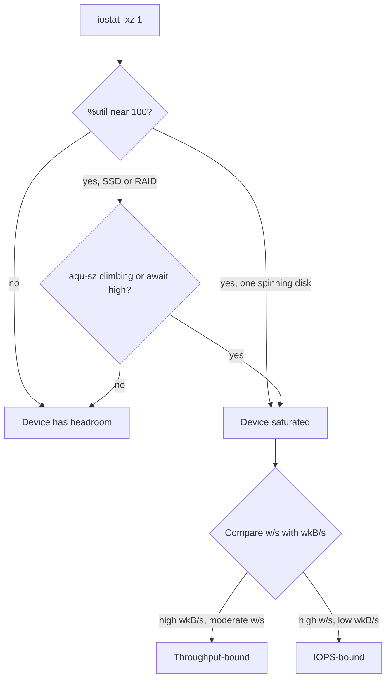

# Reading iostat Columns

You know where the numbers come from. This part runs `iostat` in the form that is useful for a live problem and reads each column in turn.

## The live form of `iostat`

A bare `iostat` gives one average since boot, which is no use for a problem happening now. For debugging you want a fresh sample every second, the extended columns, and idle devices hidden.

```sh
iostat -xz 1
```

- `-x` adds the extended statistics, the delay and queue columns.
- `-z` leaves out devices with no activity in the interval.
- `1` repeats every second. Add a count, as in `iostat -xz 1 5`, to stop after five reports.

<!-- astrona:playground:renew -->

### See it in your playground

Take three reports on the idle ship.

```sh
iostat -xz 1 3
```

Expect something like this (shortened to the columns used here):

```text
Device   r/s   w/s  rkB/s  wkB/s  r_await  w_await  aqu-sz  %util
vda     0.00  1.20   0.00   6.40     0.00     0.30    0.00   0.13
```

On an idle ship only the root device `vda` shows a stray write. `%util` is a fraction of a percent, `aqu-sz` is about 0 and `w_await` is under a millisecond. The device with `/mnt/perf` does not appear at all, because `-z` hid it. This is what healthy looks like.

## What each column says

Each column answers a different question. This section lists them, and then shows how to combine them into a verdict.

### The columns

| Column | Meaning |
| --- | --- |
| `%util` | The share of the interval in which the device had at least one request in flight. Near 100 means always busy. It is a strong signal on one spinning disk and a weak one on SSDs and RAID. |
| `aqu-sz` | The average number of requests waiting or in service. If it climbs, requests arrive faster than the device clears them. Older `sysstat` called it `avgqu-sz`. |
| `r_await` / `w_await` | The average time in milliseconds for a read or write to complete, queue time included. This is the delay the application feels. Older `sysstat` showed one combined `await`. |
| `r/s` / `w/s` | Reads and writes completed per second, which is IOPS. |
| `rkB/s` / `wkB/s` | Kilobytes read or written per second, which is throughput. |

### Why `%util` and `await` can disagree

`r_await` and `w_await` count the whole time from submit to complete. A request that waits in the queue behind others counts in full, and that is deliberate, because the queue wait is what the application sits through. `%util` only asks whether the device was doing something.

So a device can be at 100 percent `%util` with a short queue and low `await`: always busy, but keeping up. Another device that serves many requests in parallel (an SSD or a RAID array) can show a lower `%util` while `aqu-sz` and `await` climb. On those devices the queue and the delay are the earlier warning.

### A verdict in three steps



The diagram shows how to go from `%util` to a saturated verdict, and then to the kind of limit, by comparing request count with byte rate.

## Common pitfalls

> [!WARNING]
> - **Trusting `%util` on SSDs or RAID.** They serve many requests in parallel, so `%util` can read 100 while the device still has headroom. Read `aqu-sz` and `w_await` with it.
> - **Reading `iostat` with no interval.** A bare `iostat` hides any current spike. Always give an interval, as in `iostat -xz 1`.
> - **Assuming one `await` number.** Current `sysstat` splits it into `r_await` and `w_await`, and renamed `avgqu-sz` to `aqu-sz`. Older documents and older systems differ.
> - **Using a fixed delay threshold.** "20 to 30 ms is bad" is a rough rule for spinning disks. A flash array in trouble may sit at 2 ms, and a healthy archive disk at 15 ms. Compare with that device's own baseline.
