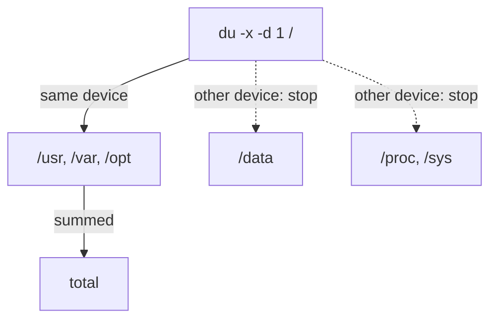

# Staying on One Filesystem & Allocated vs Apparent Size

A readable `du` can still mislead you in two ways. It can wander across mount points that it should not enter. And it can report the space a file really uses when you wanted its length, or the other way round. This part covers both.

## Staying on one filesystem: `-x`

At `/`, a plain `du` is dangerous. The root of a server is a mosaic of mounted filesystems: the local root disk, network shares and pseudo-filesystems such as `/proc` and `/sys`. The pseudo-filesystems are views into the ship's core, not storage. For example, `/proc/kcore` looks like a file the size of the address space. A `du -h -d 1 /` walks into all of them. It tries to size a network share over the wire and it produces meaningless numbers and permission errors.

The option `-x` (`--one-file-system`) stops `du` at every mount point. The mechanism is a device-ID check. Each entry that `du` looks at carries the ID of the filesystem it lives on. The command `du -x` compares that ID with the one where it started. When the walk would step onto `/data`, `/proc` or a network mount, the ID is different, so `du` does not go in. Think of it as an airlock door between two holds: `-x` refuses to open it.



The diagram shows that `-x` sums only the directories on the starting filesystem and stops at every other mount point.

<!-- astrona:playground:renew -->

### See it in your playground

Audit only the root filesystem:

```sh
du -hx -d 1 / | sort -hr
```

Expect something like this (the sizes on your machine will differ):

```text
3.1G    /
1.9G    /usr
480M    /var
257M    /opt
0       /data
0       /proc
```

`/data` and `/proc` show `0`, because `-x` refused to cross into them. Drop the `x` and run it again. `/data` jumps to about 400 MiB and `/proc` prints errors. Only the `-x` form answers "what fills the root disk?".

## Allocated blocks versus apparent size

By default `du` reports the space that is **allocated**: the blocks the filesystem really assigned. That is not always the length of the file. A **sparse file** is a file created at a large length but never fully written. The filesystem records the unwritten stretches as gaps. It gives out zeros when someone reads a gap, and it spends no blocks on it. The option `--apparent-size` makes `du` print the length stored in the inode instead. That is the number `ls -l` shows.

### See it in your playground

Look at the sparse file in three ways:

```sh
du -h /opt/archive/sparse.img
du -h --apparent-size /opt/archive/sparse.img
ls -lh /opt/archive/sparse.img
```

Expect something like this:

```text
0       /opt/archive/sparse.img
512M    /opt/archive/sparse.img
-rw-r--r-- 1 root root 512M ... /opt/archive/sparse.img
```

The default `du` says about zero, because almost no block was ever written. The other two commands say 512M, the length in the inode. When an audit and a directory listing disagree wildly, a sparse file is a common cause.

## Common pitfalls

> [!WARNING]
> - **`du` at `/` without `-x`.** It descends into `/proc`, `/sys` and every network mount. That is slow, noisy and wrong. Always add `-x` when you audit a filesystem from its root.
> - **Expecting `du` to follow symbolic links.** By default it does not. A linked directory counts as the tiny link, not its target.
> - **Comparing apparent size with `df`.** A sparse file has a large apparent size and almost no real size. Only the allocated number matches what `df` counts.
> - **Mixing up `-x` and `-d`.** The option `-x` limits the walk to one filesystem. The option `-d` limits how deep the output goes. You usually need both.

## Your mission: Directory Capacity Profiling (du -xh) Lab

You can now rank directories by size and keep the scan on one filesystem. The mission asks you to find the largest local subdirectory under `/var/log` and write its path to a file.

The mission runs on its own training ship. A playground cannot be paused, so remove it first to free memory. It always starts clean again:

```sh
astrona destroy section-080-module-01-playground
```

Then start the mission and connect to it:

```sh
astrona run --git git@github.com:astrona-io/ATS004.git -c sections/section-080/module-01/labs/lab-01
astrona ssh ats-004-lab-081
```

Read the task in [`question.md`](./labs/lab-01/question.md) and solve it on your own first. When you think you are done, send it for grading:

```sh
astrona submit -c sections/section-080/module-01/labs/lab-01
```

When the mission is done, remove it and start a fresh playground:

```sh
astrona destroy ats-004-lab-081
astrona run --git ssh://git@github.com/astrona-io/ATS004.git -c sections/section-080/module-01/playground
```
