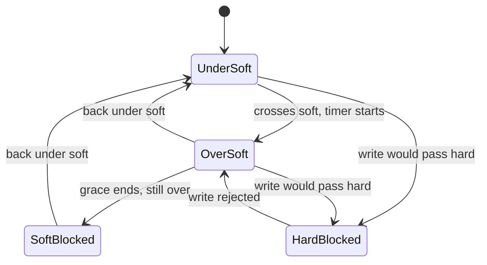

# Hitting the Limit & the Grace Period

Setting the numbers is half the job. This part watches what happens when usage reaches them: at once at the hard limit, and on a countdown at the soft limit.

## Hitting the limit

The hard limit stops a write in the middle of the operation. The check runs inside the kernel's `write()` path, so the tool that writes gets the failure straight from its own call. Nothing is held back in a buffer and written later.

<!-- astrona:playground:renew -->

### See it in your playground

Write past alice's 50M hard limit. This needs quotas on and alice's limit set with `sudo setquota -u alice 40M 50M 0 0 /quota`:

```sh
sudo -u alice dd if=/dev/zero of=/quota/alice/big bs=1M count=60
sudo -u alice ls -lh /quota/alice/big
sudo repquota -s /quota
```

Expect something like this:

```text
dd: error writing '/quota/alice/big': Disk quota exceeded
49+0 records in
48+0 records out

-rw-r--r-- 1 alice alice 49M ... /quota/alice/big

User      used   soft   hard  grace
alice     50M*   40M    50M   none
```

The command `dd` wrote in 1 MiB chunks. The write that would push the total over 50 MiB was the one that failed, so the file stops a little under the ceiling. The `repquota` report marks alice's usage with `*`, which means over the soft limit.

## The grace period

The grace period applies to the soft limit only. The hard limit never grants extra time. It is a setting of the whole filesystem, with one value for blocks and one for inodes: `setquota -t <block-grace> <inode-grace> <filesystem>`, in seconds. When a write crosses the soft limit, the kernel stamps the time on that user's record. Writes still succeed, and `repquota` shows the countdown. When the countdown reaches zero while the user is still over, the soft limit acts as a hard one.



The diagram shows the states of one user: writes succeed under soft and over soft until the timer ends, and they fail once soft is blocked or the hard limit is reached.

### See it in your playground

Set a one-hour grace period, give bob a 10M soft and 50M hard limit, and write 20 MiB as bob:

```sh
sudo setquota -t 3600 3600 /quota
sudo repquota -s /quota
sudo setquota -u bob 10M 50M 0 0 /quota
sudo -u bob dd if=/dev/zero of=/quota/bob/f bs=1M count=20
sudo repquota -s /quota
```

Expect something like this:

```text
User      used   soft   hard  grace
bob       20M*   10M    50M   59min
```

Bob is over his soft limit and under his hard limit, so writes succeed and a countdown of about an hour has started. If bob is still over 10 MiB when it reaches zero, his soft limit starts to behave like a hard limit until he deletes enough files.

## Common pitfalls

> [!WARNING]
> - **Confusing soft and hard.** Soft can be passed until the grace period runs out. Hard cannot be passed at all. Set hard as the true ceiling and soft a little below as the warning line.
> - **Testing as `root`.** Root skips the quota check, so a `dd` as root never fails. Use `sudo -u <user>`.
> - **Expecting the grace clock to restart.** The timer runs from the first crossing. Going back under soft clears it.
> - **Reading the `*` as an error.** It only marks "over the soft limit". Writes still work until grace ends or the hard limit is reached.

## Your mission: ext4 Quota Hard Limit & Grace Period Lab

You can now trace what happens at the hard limit and during the grace period. The mission asks you to cut off a write at a user's hard limit and to capture a report that shows a live grace countdown.

The mission runs on its own training ship. A playground cannot be paused, so remove it first to free memory. It always starts clean again:

```sh
astrona destroy section-080-module-02-playground
```

Then start the mission and connect to it:

```sh
astrona run --git git@github.com:astrona-io/ATS004.git -c sections/section-080/module-02/labs/lab-02
astrona ssh ats-004-lab-085
```

Read the task in [`question.md`](./labs/lab-02/question.md) and solve it on your own first. When you think you are done, send it for grading:

```sh
astrona submit -c sections/section-080/module-02/labs/lab-02
```

When the mission is done, remove it and start a fresh playground:

```sh
astrona destroy ats-004-lab-085
astrona run --git ssh://git@github.com/astrona-io/ATS004.git -c sections/section-080/module-02/playground
```
