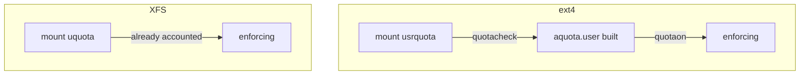

# XFS Quotas & User Limits

On ext4 you mount with an option, then run `quotacheck`, then run `quotaon`. XFS folds all of that into one step. The reason is worth knowing before the commands, because it explains why there is no XFS version of "I forgot to run quotacheck".

## XFS quotas are a mount option

XFS keeps quota usage in its own internal metadata, not in `aquota.*` files. There is no `quotacheck` and no separate `quotaon` in the normal case. Quotas are on from the moment the filesystem is mounted with the right option.

Here is the picture. On ext4, quota accounting is a logbook added later: a hidden file that must be built by walking every shelf. XFS has the logbook built into its shelving from the day it was created. It updates the running total on each allocation and each free, the same way it tracks free space. The mount option only tells the kernel to start enforcing numbers that XFS was already keeping.

- `uquota` or `usrquota` turns on user quotas, with accounting and enforcement.
- `gquota` or `grpquota` turns on group quotas.
- `pquota` or `prjquota` turns on project quotas (covered later in this module).
- `uqnoenforce`, `gqnoenforce` and `pqnoenforce` account but do not block writes. They are useful for measuring before you set limits.

Because this is a mount-time choice, XFS does not let you switch the accounting on with `mount -o remount`. To turn quotas on, unmount the filesystem and mount it again with the options, or change `/etc/fstab` and mount it again. The root filesystem needs the options on the kernel command line, because it is mounted before `/etc/fstab` is read.



The diagram shows ext4 needing two extra commands after the mount, while XFS is enforcing right after the mount.

The management tool is `xfs_quota`. Plain mode only reads. Expert mode, `-x`, is required to change anything. The option `-c '<command>'` runs one sub-command.

<!-- astrona:playground:renew -->

### See it in your playground

Check the mount options and the quota state:

```sh
findmnt -no OPTIONS /srv/xfs
sudo xfs_quota -x -c 'state' /srv/xfs
```

Expect something like this:

```text
rw,relatime,attr2,inode64,logbufs=8,logbsize=32k,usrquota,prjquota

User quota state on /srv/xfs (/dev/vdb)
  Accounting: ON
  Enforcement: ON
...
Project quota state on /srv/xfs (/dev/vdb)
  Accounting: ON
  Enforcement: ON
```

The mount has `usrquota` and `prjquota`, and `state` reports accounting and enforcement as `ON`. No `quotacheck` step was needed.

## User limits

The command `xfs_quota -x -c 'limit bsoft=<n> bhard=<n> <user>' <filesystem>` sets a user's block limits. Use `isoft=` and `ihard=` for file counts. The command `report` shows usage, and `-h` prints human units.

### See it in your playground

Limit alice and then go past the limit:

```sh
sudo xfs_quota -x -c 'limit bsoft=40m bhard=50m alice' /srv/xfs
sudo xfs_quota -x -c 'report -h' /srv/xfs
sudo -u alice dd if=/dev/zero of=/srv/xfs/alice-file bs=1M count=60
sudo xfs_quota -x -c 'report -h' /srv/xfs
```

Expect something like this:

```text
User quota on /srv/xfs (/dev/vdb)
                        Blocks
User        Used   Soft   Hard Warn/Grace
alice          0     40M    50M  00 [------]

dd: error writing '/srv/xfs/alice-file': Disk quota exceeded
49+0 records in

alice         50M    40M    50M  00 [--------]
```

Alice's writes stop at the 50 MiB hard limit with the same "Disk quota exceeded" error as on ext4. The check at write time is the same. Only the place where the numbers live is different.

## Common pitfalls

> [!WARNING]
> - **Looking for `quotacheck` or `aquota.user`.** XFS has neither. The accounting lives in the filesystem's own metadata.
> - **Forgetting `-x`.** Without expert mode, `xfs_quota` cannot change limits.
> - **Trying to turn quotas on with `mount -o remount`.** XFS reads its quota options at mount time. Unmount and mount again.
> - **Using `setquota` or `repquota` on XFS.** Those tools read `aquota.*` files, which do not exist on XFS. Use `xfs_quota`.
