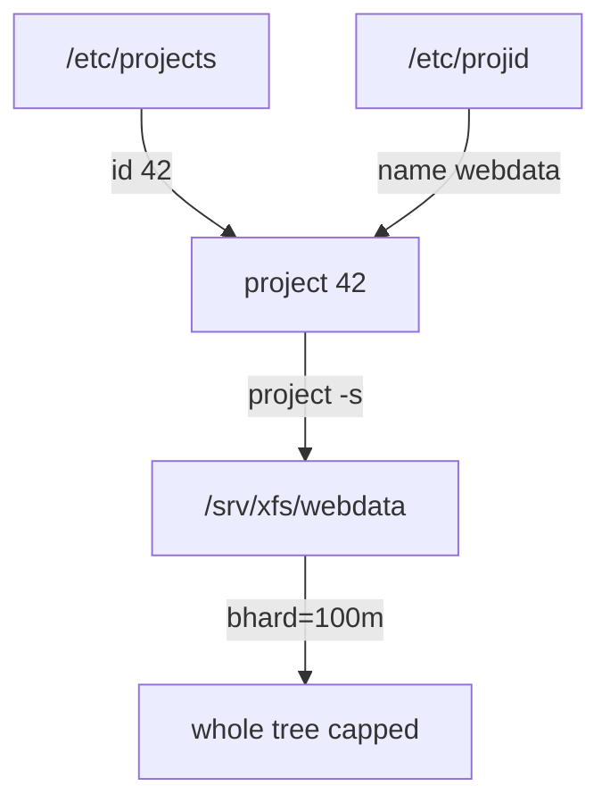

# Defining & Enforcing a Project Quota

User and group quotas cap who owns the data. A **project quota** caps a directory tree, whoever owns the files in it. It is the tool for "this directory may use at most 10 GB, whichever service account writes into it". Think of it as an allowance for one mission, not for one crew member.

## Defining a project

A project is a number attached to a directory tree. Every file created in that tree carries the number, and the project's quota caps the whole tree. Two files describe it:

- `/etc/projects` holds `<id>:<path>`, the number and its directory.
- `/etc/projid` holds `<name>:<id>`, a friendly name for the number.

Then `xfs_quota -x -c 'project -s <name>' <filesystem>` walks the tree and stamps the number onto the files that already exist. This is the one place where XFS quotas need a setup pass. The project number is stored in each inode, so files that existed before the project have no number yet. The pass also sets an inheritance flag on the directory, so every new file is stamped when it is created. No scan is needed again.

<!-- astrona:playground:renew -->

### See it in your playground

Create the `webdata` project and report on it:

```sh
echo '42:/srv/xfs/webdata' | sudo tee -a /etc/projects
echo 'webdata:42' | sudo tee -a /etc/projid
sudo xfs_quota -x -c 'project -s webdata' /srv/xfs
sudo xfs_quota -x -c 'report -p -h' /srv/xfs
```

Expect something like this:

```text
Setting up project webdata (path /srv/xfs/webdata)...
Processed 1 (/etc/projects and cmdline) paths for project webdata

Project quota on /srv/xfs (/dev/vdb)
                        Blocks
Project     Used   Soft   Hard Warn/Grace
webdata        0      0      0  00 [------]
```

The project exists and `report -p` lists it, with no limit yet. Everything under `/srv/xfs/webdata` now carries project number 42.

## Enforcing a project quota

The command `xfs_quota -x -c 'limit -p bhard=<n> <name>' <filesystem>` sets the project's limit. From then on, the combined size of everything in the tree is capped. The kernel checks the project number stamped on the file being written, not the owner.



The diagram shows the two files naming the project, the stamping pass tying it to the directory, and one limit covering the whole tree.

### See it in your playground

Cap the directory and write as two different users:

```sh
sudo xfs_quota -x -c 'limit -p bhard=100m webdata' /srv/xfs
sudo -u alice dd if=/dev/zero of=/srv/xfs/webdata/a bs=1M count=70
sudo -u bob   dd if=/dev/zero of=/srv/xfs/webdata/b bs=1M count=70
sudo xfs_quota -x -c 'report -p -h' /srv/xfs
```

Expect something like this:

```text
(alice's dd succeeds — ~70M)
dd: error writing '/srv/xfs/webdata/b': Disk quota exceeded
30+0 records in

Project     Used   Soft   Hard Warn/Grace
webdata      100M     0    100M  00 [--------]
```

Alice wrote about 70 MiB. Bob could add only about 30 MiB before the tree reached 100 MiB, although bob has no personal quota and does not own the tree. The check used project number 42, which every file there carries.

## Common pitfalls

> [!WARNING]
> - **Setting a project limit before `project -s`.** Run the stamping pass first. Without it, the existing files have no project number.
> - **`pquota` and `gquota` together.** On some kernels they cannot be used together because they share an on-disk field. Pick what you need and combine it with `uquota`.
> - **Root filesystem quotas through fstab only.** For `/`, the options must be on the kernel command line.
> - **A typo in the two files.** `/etc/projects` maps number to path. `/etc/projid` maps name to number. Mixing the order gives "project not found" errors.

## Your mission: XFS Project Quota Lab

You can now set a user quota and a project quota on XFS. The mission asks you to limit alice, define the `webdata` project for a directory, and cap it.

The mission runs on its own training ship. A playground cannot be paused, so remove it first to free memory. It always starts clean again:

```sh
astrona destroy section-080-module-03-playground
```

Then start the mission and connect to it:

```sh
astrona run --git git@github.com:astrona-io/ATS004.git -c sections/section-080/module-03/labs/lab-01
astrona ssh ats-004-lab-084
```

Read the task in [`question.md`](./labs/lab-01/question.md) and solve it on your own first. When you think you are done, send it for grading:

```sh
astrona submit -c sections/section-080/module-03/labs/lab-01
```

When the mission is done, remove it and start a fresh playground:

```sh
astrona destroy ats-004-lab-084
astrona run --git ssh://git@github.com/astrona-io/ATS004.git -c sections/section-080/module-03/playground
```
