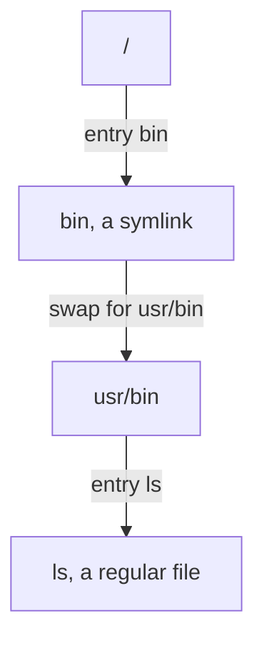
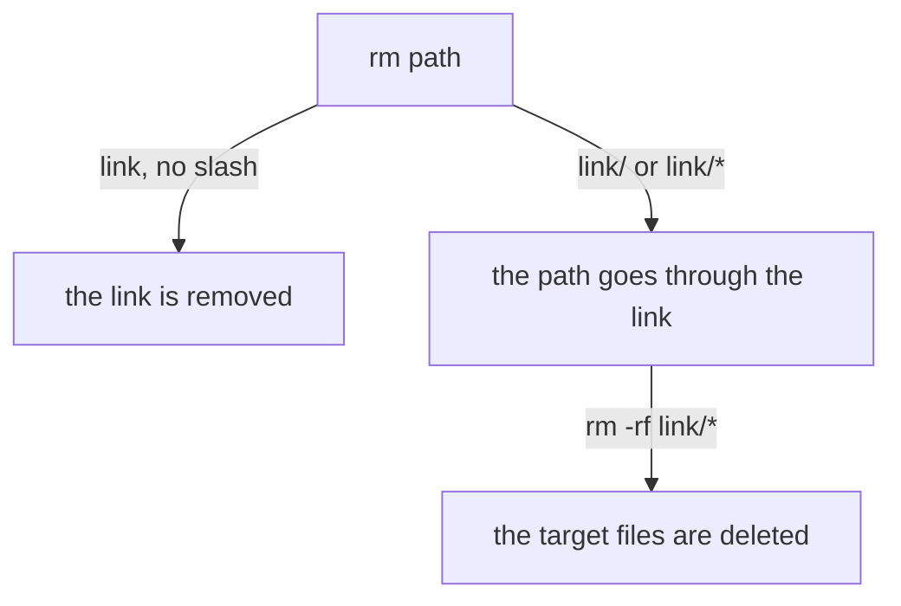

# Resolving, du's Blind Spot & Removing Safely

The one rule from earlier, that the kernel swaps a link for its stored path, now does three jobs. It shows where a chain of links ends, it explains a `du` result that looks wrong, and it explains the one case where a harmless `rm` can destroy data.

## Resolving where a link points

Several tools answer "where does this go?", each with more thoroughness than the last:

- `ls -ld <link>` shows the target as stored, often a relative path such as `/bin -> usr/bin`.
- `readlink <link>` prints only that stored text. Nothing is resolved.
- `readlink -f <link>` and `realpath <link>` do the swap, again and again if the target is itself a link, and print the final absolute path.
- `namei -l <path>` shows every step of the resolution, link by link, with permissions.



The diagram shows the kernel meeting the link named `bin` and continuing from `usr/bin`.

<!-- astrona:playground:renew -->

### See it in your playground

Compare the stored target with the fully resolved path:

```sh
readlink /bin
readlink -f /bin
realpath /bin
namei -l /bin/ls
```

Expect something like this:

```text
usr/bin
/usr/bin
/usr/bin
f: /bin/ls
 dr-xr-xr-x root root /
 lrwxrwxrwx root root bin -> usr/bin
 drwxr-xr-x root root   usr
 drwxr-xr-x root root   bin
 -rwxr-xr-x root root   ls
```

The plain `readlink` gives the relative `usr/bin` stored in the link. The commands `readlink -f` and `realpath` do the swap and print the absolute `/usr/bin`. The command `namei -l` shows the hop where `bin` becomes `usr/bin`, which helps when a path holds several links.

## `du` and symlinks

A symlink's own size is the length of its stored path, a handful of bytes. By default `du` does not follow it. It treats the link as an object, the same way `find -type l` does. So measuring a linked directory reports almost nothing.

### See it in your playground

Weigh the link and its target:

```sh
du -sh /bin
du -sh /usr/bin
```

Expect something like this (the second size depends on your system):

```text
0       /bin
180M    /usr/bin
```

The command `du -sh /bin` reports `0` because `/bin` is a 7-byte link and `du` stops there. The real space is under `/usr/bin`. In a capacity audit this is what you want. Otherwise you would count the same data once under the real path and once under each link.

## Removing a symlink safely

To delete a link and keep its target, name the link with no slash after it:

```sh
rm /tmp/rmdemo/link
```

The command `rm` removes the last name in the path as typed. It does not need to look at what the link points to. A glob or a trailing slash changes this, because both make the shell or the kernel go through the link into the target directory. The command `rm -rf /tmp/rmdemo/link/*` does not remove the link. The shell expands `link/*` through the link into the files of the target, and `rm` deletes those files. Tab completion often adds the slash for you, which is how this usually happens by accident.



The diagram shows that a plain link name removes only the link, while a slash or a glob walks into the target.

### See it in your playground

Rebuild the disposable demo, then remove the link and keep the data:

```sh
reset-symlink-demo
ls -ld /tmp/rmdemo/link
rm /tmp/rmdemo/link
ls /tmp/rmdemo/
ls /tmp/rmdemo/real/
```

Expect something like this:

```text
rebuilt: /tmp/rmdemo/real (2 files) and /tmp/rmdemo/link -> /tmp/rmdemo/real
lrwxrwxrwx 1 root root 14 ... /tmp/rmdemo/link -> /tmp/rmdemo/real
(after rm:)
real
a.txt  b.txt
```

The link is gone, and `real/` and both files remain. To see the danger on purpose, run `reset-symlink-demo` again, then `rm -rf /tmp/rmdemo/link/*`, then `ls /tmp/rmdemo/real/`. Do this only in that disposable directory, and run `reset-symlink-demo` again afterwards.

Before you remove any link, check what it is: `ls -ld <path>`.

## Common pitfalls

> [!WARNING]
> - **A slash or a glob after a link.** `link/` and `link/*` go through the link into the target. Before you `rm` a link, run `ls -ld <path>`.
> - **`readlink` without `-f` in a script.** The plain output can be a relative path that only makes sense from the link's folder. Use `readlink -f` or `realpath` for an absolute path.
> - **Auditing with `find -L`.** It follows every link, so you audit targets, not links. Use `-type l`.
> - **A dangling link.** If the target moved, the link stays and points at nothing. Resolving through it fails with "No such file or directory".

## Your mission: Navigating Shortcuts: Symbolic Links Lab

You can now find links, read where they point and remove them safely. The mission asks you to audit the links under `/usr/share/lab-links` and record the ones that match a target pattern.

The mission runs on its own training ship. A playground cannot be paused, so remove it first to free memory. It always starts clean again:

```sh
astrona destroy section-080-module-04-playground
```

Then start the mission and connect to it:

```sh
astrona run --git git@github.com:astrona-io/ATS004.git -c sections/section-080/module-04/labs/lab-01
astrona ssh ats-004-lab-082
```

Read the task in [`question.md`](./labs/lab-01/question.md) and solve it on your own first. When you think you are done, send it for grading:

```sh
astrona submit -c sections/section-080/module-04/labs/lab-01
```

When the mission is done, remove it and start a fresh playground:

```sh
astrona destroy ats-004-lab-082
astrona run --git ssh://git@github.com/astrona-io/ATS004.git -c sections/section-080/module-04/playground
```
